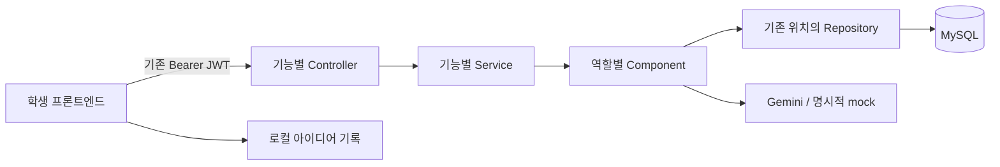

# 백엔드 구성과 처리 규칙

갱신: 2026-10-27 (한국 시간). 이 문서는 실제 구현 기준이다.
[요구사항 원문](https://app.notion.com/p/3f89fa2a819d8048a0e6fca0e6645436)의 화면·업무 의미를 참고하고,
사용자 결정에 따라 Kotlin/Spring Boot, MySQL, 기존 자체 회원·JWT 인증을 사용한다.

## 1. 구조와 책임

- Controller: 기존 `@Api`, `@Auth`/`@Auths`, `@Valid`, Swagger로 경로·입력·인증·응답을 선언한다.
- Service: Controller와 Component 연결, 여러 Component의 실행 순서·결과 조합을 맡는다. Repository를 직접 호출하지 않는다.
- Component: 조회·저장·추출·연관 단어 매칭·생성·출력 검증 등 개별 역할을 맡는다.
- DTO: `core/dto/app/<feature>`, Entity: `core/entity`, Repository: `infra/repository`.
- 외부 AI 어댑터는 `infra/ai`, 공통 생성 조정·제한·문자열 정책은 `lib/common/component`에 둔다.
- 트랜잭션은 DB 작업 Component의 공개 메서드에 둔다. AI 네트워크 호출을 DB 트랜잭션 안에 넣지 않는다.

| 기능 패키지 | Controller / Service | 역할별 Component |
| --- | --- | --- |
| main/app/user | 기존 회원 API | UserComponent, UserIdentityComponent |
| main/app/category | 카테고리 조회·미리보기·추가 | CategoryComponent |
| main/app/word | 추출·고정·방향성 | WordComponent, WordMatchComponent, WordMatchCacheComponent |
| main/app/idea | 생성·조회·재조합 | IdeaStorageComponent, IdeaGenerationComponent |
| main/app/recipe | 만드는 법 | RecipeComponent, RecipeGenerationComponent |
| main/app/post | 링크 생성·게시·피드·반응 | PostComponent, FeedComponent |
| main/app/share | 공개 읽기 HTML | ShareHtmlComponent |
| main/common/health | 서버 준비 상태 | HealthComponent |

API 경로와 JSON은 [API_SPEC.md](API_SPEC.md), 학생 실행은 [README](../README.md), 요청 예제는 [requests.http](requests.http)를 참고한다.
신규 API도 기존 `/app` 규칙을 따르므로 노션의 루트 경로와 다르다.

## 2. MySQL 구조

기존 `users`, `ip` 테이블과 자체 인증을 유지하고 업무 테이블 9개를 추가했다.
외부 업무 ID는 UUID 문자열, 회원 FK는 기존 `users.idx` BIGINT, 시각은 UTC ISO-8601이다.

| 테이블 | 역할·제약 |
| --- | --- |
| categories | 정규화 name_key UNIQUE, 기본/사용자 구분, 만든 회원·사용 횟수 |
| words | text_key UNIQUE, 표시 단어와 검색용 keywords 텍스트 |
| category_words | 카테고리-단어 연결, (category_id,word_id) UNIQUE |
| ideas | combo_key UNIQUE, 카테고리·방향성·제목·내용·원본 ID·AI source·hidden |
| idea_words | 단어 3개와 표시 순서, (idea_id,position) 및 (idea_id,word_id) UNIQUE |
| recipes | idea_id PK/FK, food/software/contest/general 분야별 가이드. 기존 plan은 요청 시 현재 유형으로 재생성 |
| posts | link/feed, 공유 코드 UNIQUE, (idea_id,user_idx,scope) UNIQUE |
| reactions | (post_id,user_idx) UNIQUE, like/meh/dislike CHECK |
| match_cache | 입력·후보 풀·AI 버전 해시 키, 선택 ID JSON, 만료 시각 |

카테고리-단어·글-회원·반응 등의 FK를 DB에 둔다. 새 마이그레이션은 `db/v2`이며 새 DB에서 적용·기동을 확인했다.
기획 초안의 별도 word_keywords/app_metadata 테이블은 만들지 않았다. 작은 초기 단어 풀에서는 words.keywords와
캐시 키의 실제 후보 내용 해시로 충분하여 관리 지점을 줄였다.
이미 배포·적용한 changeset은 고치지 말고 새 변경 이력을 추가한다.

### 기본 데이터

- 음식 개발: 149개, 프로그램 개발: 152개, 공모전 주제선정: 148개.
- 공통 단어는 중복을 합쳐 441개, 카테고리 연결은 449개다.
- UUID는 시드에서 결정적으로 생성한다. 같은 시드가 다시 적용되어도 기존 회원·아이디어를 덮어쓰지 않는다.
- 사용자 카테고리는 관련 단어 최대 40개, 최소 10개 이상으로 만든다. 기본 카테고리 100개 목표와 구분한다.
- 노션의 별도 2,311개 단어를 반입했다고 간주하지 않는다.
- 자동 시연 회원·피드는 생성하지 않는다. 회원은 기존 회원가입 API로 만든다.

## 3. 인증과 공통 처리

기존 가입·로그인·갱신 경로와 응답 DTO를 유지한다. 기존 비밀번호 HMAC 처리도 유지했다.
Jwt에서 서명·issuer·만료·토큰 용도를 확인하며 AuthComponent에서 DB 회원 존재·권한을 확인한다.
refresh를 업무 토큰으로 쓰거나 access로 갱신하는 요청은 401이다.
기존 발급 토큰에는 토큰 용도·issuer가 없으므로 이번 변경 후 다시 로그인해야 한다.

`@Auth`는 local을 포함해 모든 실행 프로필에서 적용한다. 본인 프로필은 일반 USER도 조회할 수 있다.
신규 글·카테고리·반응의 회원은 토큰으로 결정한다. 입력 userId를 받아 소유자를 바꾸지 않는다.
기존 회원 기능도 UserService의 조합과 UserComponent의 개별 처리로 분리했다.

기존 개발용 비밀번호 조회·IP 초기화·고의 오류·사용자 락 시연 경로는 학생 API에서 차단했다.
CORS는 설정된 개발 Origin만 허용하고 쿠키 없이 Bearer 헤더를 쓴다.
기본 Origin은 localhost의 8081·5173·3000이며 학생 실행 주소에 맞춰 CORS_ORIGINS를 갱신한다.
API 오류는 기존 `code`, `name`, `message` 구조로 통일했다. 429에는 Retry-After를 넣는다.
요청 본문·Authorization·비밀번호를 오류 로그에 넣지 않는다. 외부 알림은 기본 빈 설정으로 비활성화되어 있다.

## 4. 추출·매칭

- 카테고리 후보에서 서로 다른 단어를 정확히 3개 반환한다.
- 고정은 0~2개. 중복·없는 단어·카테고리 밖 단어는 400이다.
- 리롤은 후보가 충분하면 직전 비고정 단어를 우선 제외한다.
- 방향성이 있으면 정규화된 토큰과 단어·연관 태그로 후보를 점수화하고 최상위 관련 후보를 우선 사용한다.
- 직접 매칭이 부족하고 실제 Gemini 모드일 때만 기존 후보 ID 중 관련 단어를 AI가 선택한다. ID·중복·개수는 서버가 검증한다.
- AI 후보 선택은 하루 캐시하며 키에는 입력·실제 후보 풀·모델/프롬프트 버전이 들어간다.
- mock은 시드 태그로만 매칭하며 무관한 단어를 관련 있다고 꾸미지 않는다. 후보 부족은 422다.
- use_count는 성공한 추출당 한 번 증가하며 목록·미리보기에는 증가시키지 않는다.

방향성 없는 추출과 태그 검색은 외부 AI를 호출하지 않는다. 최초 의미 매칭은 외부 지연이 있으므로 일반 리롤과 성능을 나누어 측정해야 한다.

## 5. 생성·캐시·동시성

아이디어 키는 카테고리, 정렬한 단어 ID 3개, 정규화 방향성, AI 모드·모델·프롬프트 버전으로 만든 SHA-256이다.
같은 단어 순서만 바뀐 요청도 같은 결과를 재사용한다. mock과 실제 Gemini 결과는 키가 다르다.
캐시 적중은 AI 제한을 소모하지 않는다.

GenerationCoordinatorComponent는 같은 키의 진행 중 작업 하나에 동시 요청을 합친다.
저장은 DB 트랜잭션으로 짧게 처리하고, DB UNIQUE 충돌이면 이미 저장된 결과를 읽는다.
UNIQUE만으로 AI 중복 호출이 방지되는 것은 아니므로 두 책임을 분리했다.
실패한 작업은 진행 목록에서 제거하여 다음 요청이 다시 시도할 수 있다.
hidden 결과는 일반 조회·조합 캐시·공유·반응·피드에서 제외한다.

재조합은 임의 변형 키와 parentIdeaId로 새 결과를 저장하며 기본 조합을 덮어쓰지 않는다.
제목·내용의 빈 값·길이·기본 금칙어와 AI JSON 구조를 확인하고 실패 결과는 저장하지 않는다.
만드는 법도 아이디어별 진행 작업을 합치며 최초 결과를 저장·재사용한다.
후속 가이드는 모든 분야에 제공한다. `GuideTypeComponent`가 categories.guide_type을 읽고 조리법·구현 가이드·공모전 기획안·실행 계획을 구분한다. `guideType`·`guideLabel`·`hasGuide`를 DTO로 전달한다. `supportsRecipe`는 기존 클라이언트를 위한 음식 여부이며 후속 버튼 숨김에 쓰지 않는다.
새 `main/app/guide`의 Controller → Service → Component가 유형·생성 검증·저장을 분리한다. 신규 `/guide`는 requirements(name/detail) 구조를, 기존 `/recipe`는 호환 구조를 유지하며 동일 생성·캐시 처리를 사용한다. 사용자 카테고리는 생성 시 유형을 선택하고 생략 시 general이다.
AI 지시문은 분야별로 구분하며 해당 아이디어의 실제 구현·기획·실험을 다룬다. 타입 불일치·잘못된 구조는 저장하지 않고, 불가능 결과는 이유와 빈 배열로 반환한다. 기존 plan은 요청 시 새 유형으로 교체하고 공유 GET에서는 AI를 호출하지 않는다. DB 변경은 v3의 새 Liquibase 이력으로만 적용한다.

## 6. 공유·피드·반응

링크 공유와 피드 게시를 scope로 구분한다. 링크 생성만으로 피드에 게시하지 않는다.
같은 회원·아이디어·scope는 기존 글·코드를 반환하며 새 코드는 충분히 긴 난수로 생성한다.
공유 HTML은 서버 텍스트를 이스케이프하고 공개 조회에서 AI를 새로 호출하지 않는다.
공개 URL은 SERVER_PUBLIC_URL로 만든다. localhost 링크는 해당 PC에서만 열 수 있다.

피드는 최신순 또는 인기순(like-dislike), 생성 시각·ID까지 정렬한 커서로 조회한다.
반응 수는 MySQL 집계, 표시 단어는 일괄 조회해 페이지당 불필요한 반복 조회를 줄였다.
인기순은 반응 변화로 이동할 수 있으므로 프론트는 글 ID로 중복을 제거하고 새로고침 시 커서를 초기화한다.

반응 변경은 게시글 행 잠금을 잡는 짧은 트랜잭션에서 수행한다.
사용자당 글에 한 반응만 저장하고, 변경은 갱신, 취소는 삭제다. 자기 글 반응은 403이다.

## 7. AI와 실행 설정

Gemini는 공식 generateContent REST와 JSON 응답 스키마를 사용한다.
모델은 AI_MODEL, 키는 GEMINI_API_KEY로만 전달하고 서버 밖에 노출하지 않는다.
아이디어 5초, 후보 선택 15초, 만드는 법 20초, 실제 AI 동시 실행 기본 4개로 제한한다.
실제 모드에 키가 없거나 API가 실패한 경우 503/502/504 등을 반환하며 mock 성공으로 바꾸지 않는다.

mock은 AI_MODE=mock일 때만 사용한다. 예시라는 표시와 source:mock이 응답에 포함된다.
기본 제한은 생성 회원당 10회/분, 만드는 법 5회/분, preview 20회/분, 사용자 카테고리 10개/일이다.
IP당 한도도 회원 한도의 3배로 적용한다. 실제 수치는 app.limits에서 바꿀 수 있다.

실행·테스트 스크립트는 Windows의 Java AF_UNIX 임시 경로 문제를 피하는 설정을 포함한다.
Docker Compose는 로컬 MySQL 실행 대안이고, 이번 실제 검증은 설치된 MySQL 8.0의 격리 DB에서 수행했다.
Gemini 구현 참고: [생성 API](https://ai.google.dev/api/generate-content), [구조화 출력](https://ai.google.dev/gemini-api/docs/structured-output).

## 8. 검증 범위와 남은 확인

MySQL에서 마이그레이션·시드·기존 인증·업무 흐름·동시 생성 1회·캐시·잘못된 출력 미저장·공유·페이지 이동·반응 변경/취소를 검증했다.
추가로 토큰 위조·만료·용도, 단일 작업 실패 후 재시도, HTML 이스케이프, 호출 제한을 검증했다.
정확한 실행 결과는 [작업 기록](WORK_LOG.md)에 기록한다.

- 실제 Gemini 키·모델 조회, 아이디어·재조합·만드는 법·후보 매칭을 확인했다. 상세 연결 결과는 GEMINI_SETUP.md에 기록했다.
- 학생 프론트 소스가 없어 실제 화면과 DTO·로그인 동선 대조는 남아 있다.
- 리롤 0.5초·AI 결과 5초는 목표다. 종합 성능·부하·외부 실패 주입 검증을 완료했다고 주장하지 않는다.
- 동시 작업 공유·호출 제한은 단일 API 인스턴스 메모리 기준이다. 여러 서버에서는 공유 저장소로 확장해야 한다.
- 현재 동기 HTTP 방식은 브라우저 취소 즉시 외부 생성·과금 취소를 보장하지 않는다.
- 금칙어 검사는 기본 규칙이며 완전한 콘텐츠 심사·신고 기능은 없다.
- 기기 설치·기기 오류 확인은 사용자 지시에 따라 생략했다. 원격 배포도 수행하지 않았다.

## 9. 업데이트 위치

서버는 src/main/kotlin/com/ideasupport, MySQL은 src/main/resources/db, 설정은 src/main/resources/.env와 application YAML이다.
학생 프론트에서는 API 주소·기존 로그인/갱신·DTO·오류 매핑을 연결한다.
API 계약은 API_SPEC.md·Swagger, 구조는 이 문서, 결과는 WORK_LOG.md를 함께 갱신한다.
노션 원문은 수정하지 않았으므로 추후 6주차 서버·DB·인증 선택을 현재 결정에 맞춰 갱신할 수 있다.
