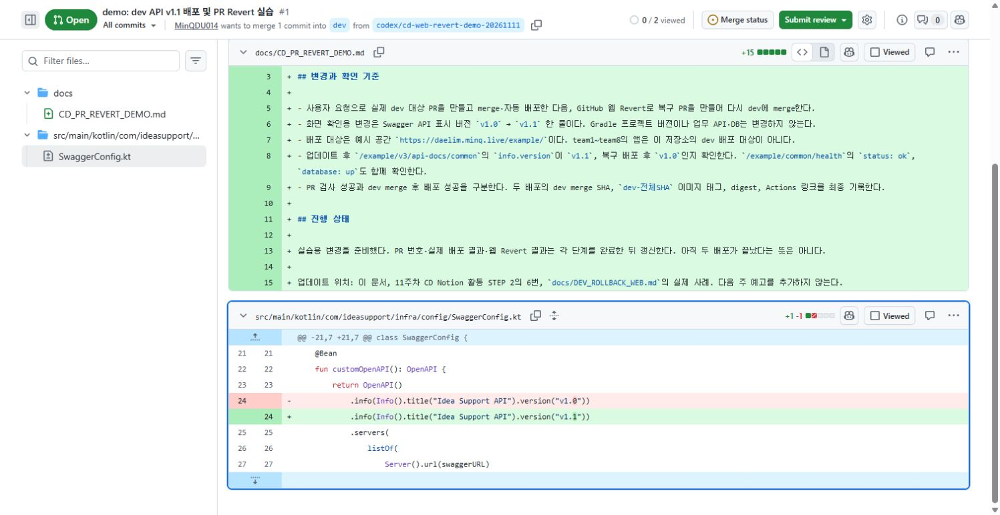
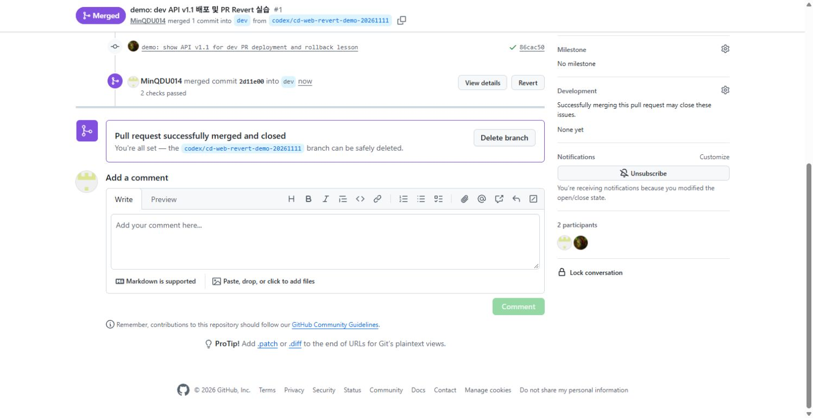
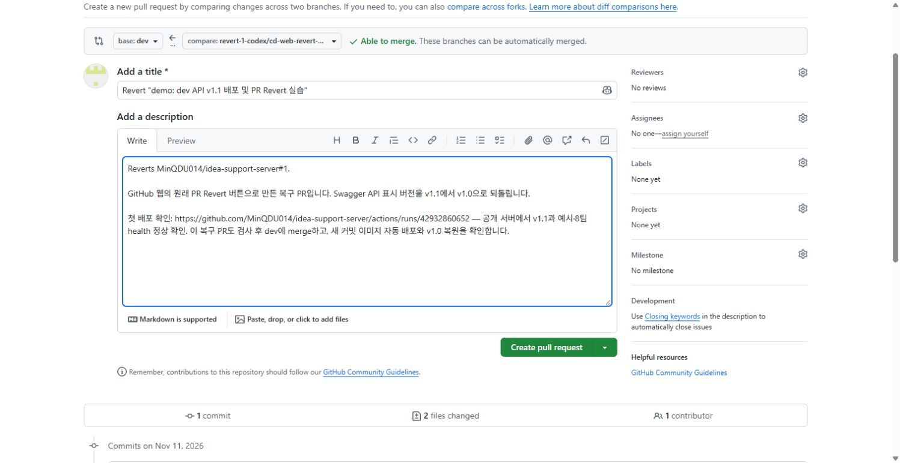
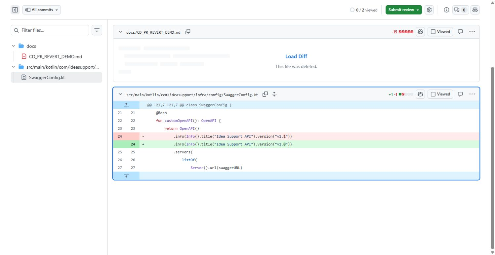
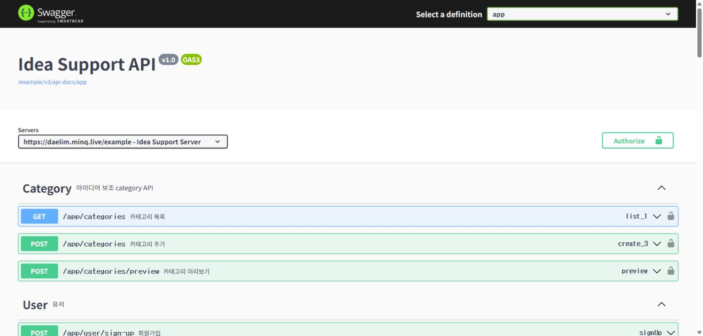

# 2026-11-11 실제 dev PR 배포와 GitHub 웹 Revert

## 버전과 커밋

이번 버전은 **Swagger에 표시되는 API 버전**이다. Gradle 프로젝트 버전은 기존 `0.0.1-SNAPSHOT`을 유지했다. 업무 API·DB는 수정하지 않았다. 배포 대상은 강사 예시 앱 `/example/`이며 team1~team8 앱은 이 저장소의 배포 대상이 아니다.

| 구분 | API 표시 버전 | PR | dev merge SHA | 자동 배포 |
| --- | --- | --- | --- | --- |
| 업데이트 | `v1.1` | [#1](https://github.com/MinQDU014/idea-support-server/pull/1) | `2d11e007dfa0e821c65c009183d25f660390f236` | [42932860652](https://github.com/MinQDU014/idea-support-server/actions/runs/42932860652), 성공·공개 서버 확인 |
| 웹 Revert 후 복구 | `v1.0` | [#2](https://github.com/MinQDU014/idea-support-server/pull/2) | `61b811088e55146142596ac31788d3546025f5fc` | [42934053632](https://github.com/MinQDU014/idea-support-server/actions/runs/42934053632), 성공·공개 서버 확인 |

**취소할 원래 변경 SHA:** [`86cac508fd4a49bb5158f0453fd14bb4310cefd3`](https://github.com/MinQDU014/idea-support-server/commit/86cac508fd4a49bb5158f0453fd14bb4310cefd3). 이 커밋이 Swagger의 `v1.0`을 `v1.1`로 바꿨다. `BAD_COMMIT_SHA`는 이런 변경 커밋 번호를 넣는 자리표시자다.

**GitHub 웹이 만든 Revert 커밋 SHA:** [`d6738cf6b002c2649566373f983a454a548a96b7`](https://github.com/MinQDU014/idea-support-server/commit/d6738cf6b002c2649566373f983a454a548a96b7). 이 변경을 PR #2로 dev에 합친 결과가 위 `61b8110…`이다. 웹 Revert 화면에는 SHA를 직접 입력하지 않았다.

## 이미지 버전

- 업데이트: `docker.minq.live/team/idea-support-server:dev-2d11e007dfa0e821c65c009183d25f660390f236`
- 복구 배포: `docker.minq.live/team/idea-support-server:dev-61b811088e55146142596ac31788d3546025f5fc`
- 공통 최신 태그: `docker.minq.live/team/idea-support-server:latest`. 실제 복구 배포 후 이 태그와 복구 커밋 태그가 서버의 실행 digest와 일치함을 Registry HEAD·CD 상태 GET으로 확인했다.
- 업데이트 실행 digest: `sha256:e7f006d5919011ef170ec0318cb22c15fd60de53d02a67e6c6c67e770a20bfa2`.
- 복구 실행 digest: `sha256:231bd53f691ef1df684e62f83ac8784fcaef813578453dfd78706468fa3cfc51`.

## 실제로 누른 화면 순서

1. PR #1에서 **Checks 통과 → Merge pull request → Confirm merge**로 dev에 합쳤다.
2. 첫 자동 배포 성공 뒤 [Swagger](https://daelim.minq.live/example/swagger-ui/index.html)와 [OpenAPI](https://daelim.minq.live/example/v3/api-docs/common)에서 `v1.1`을 확인했다. 예시 앱과 8팀 앱의 health도 모두 정상이다.
3. 원래 PR #1 아래쪽 merge 기록의 **Revert** 버튼을 눌렀다. 비교 화면의 **base: dev**와 반대 변경 `v1.1 → v1.0`을 확인하고 **Create pull request**로 PR #2를 만들었다.
4. PR #2의 검사도 189개 테스트를 통과했다. **Merge pull request → Confirm merge**로 dev에 합쳤다.
5. 두 번째 Actions 실행 성공 뒤 공개 Swagger·OpenAPI의 `v1.0`, CD 상태의 revision `61b8110…`, `latest`·커밋 태그·서버 실행 digest 일치를 확인했다. 예시+8팀 health 9개도 모두 `status: ok`, `database: up`이다. PR 두 번과 push 배포 두 번의 테스트는 각각 189개를 통과했다.

## 실제 화면

PR #1에서 `v1.0 → v1.1` 변경과 대상 dev를 확인했다.

첫 배포가 끝난 뒤 공개 Swagger에서 `v1.1`을 확인했다.

원래 PR #1의 merge 기록에서 Revert를 눌렀다. 공식 예시 이미지가 아니라 이 저장소에서 실행한 화면이다.

복구 PR 생성 화면의 base가 dev인지 확인하고 Create pull request를 눌렀다.

PR #2의 Files changed에는 `v1.1 → v1.0`의 반대 변경이 들어 있다.

복구 PR을 dev에 합친 뒤 새 이미지가 배포됐고 공개 Swagger는 다시 `v1.0`이다.

비밀값 없는 원본 검증 값: [배포 전·업데이트·복구 JSON](evidence/classroom-cd/pr-revert-demo.json). 최종 확인 시각은 2026-11-11 09:52:59 KST다. 이전 baseline digest와 복구 digest는 다르지만 API 표시 버전과 코드 변경은 복원됐다. 같은 옛 이미지 digest를 재사용한 복구로 설명하지 않는다.

## 확인 경계와 업데이트 위치

원래 PR은 의도적인 표시 버전 실습이며 장애 배포가 아니다. 원래 기록을 지우거나 강제로 dev를 과거 SHA로 이동하지 않았다. 새 복구 merge 커밋의 이미지를 다시 빌드·배포한다. 코드 복구는 DB 복원을 뜻하지 않는다.

실습 PR에 함께 들어갔던 최초 준비 문서는 Revert로 삭제됐다. 이 파일은 실제 결과를 남기기 위해 문서 커밋에서 다시 만든 기록이다. 표시 버전 변경을 다시 적용하지 않는다.

업데이트 위치: [11주차 CD Notion](https://app.notion.com/p/project-2026-01/11-CD-40d9fa2a819d801ebbbbf605cc00843f)의 활동 STEP 2 → 6번, [화면별 학생 안내](DEV_ROLLBACK_WEB.md), 이 기록. 다음 주 예고는 추가하지 않는다.
