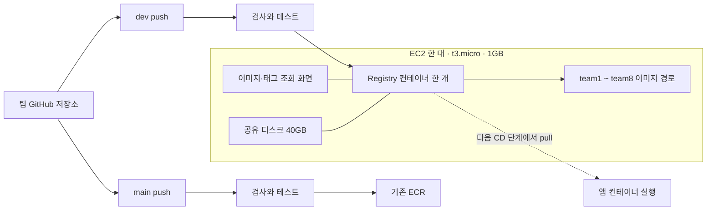

# 10주차 보충 — EC2의 공유 Registry와 dev 브랜치

ECR 실습에 직접 운영하는 이미지 저장소를 추가합니다. EC2는 AWS의 가상 서버지만, 그 안의 Docker와 Registry를 직접 설치하고 운영하는 흐름은 온프레미스와 같습니다.

학생은 EC2에 접속할 필요가 없습니다. 각자 GitHub의 dev 브랜치에 코드를 올리면 GitHub Actions가 이미지를 만들고 `https://docker.minq.live`로 업로드합니다. 사이트는 업로드 결과를 보는 화면이며 브라우저에서 이미지 파일을 첨부하는 방식은 아닙니다.

## 서버 한 대, Registry 한 개

팀마다 EC2나 Registry 컨테이너를 만들 필요는 없습니다. 같은 Registry에 `team1/idea-support-server`부터 `team8/idea-support-server`까지 이름을 나누면 됩니다. Registry 한 개는 여러 이미지·태그·동시 업로드를 처리할 수 있습니다.

| 브랜치 | 이미지 저장소 | 앱 빌드 환경 |
| --- | --- | --- |
| `main` | 기존 ECR의 팀별 레포 | `prod` |
| `dev` | EC2의 공유 Registry | `dev` |
| `dev`로 보내는 PR | 검사만 실행 | 이미지 업로드 없음 |



이미지 이름은 팀을, 태그는 버전을 구분합니다. `dev` 태그로 최신 개발 이미지를 찾고, `dev-커밋전체번호` 또는 digest로 CD에서 실행할 버전을 정확히 지정합니다. 같은 내용의 레이어는 Registry 안에서 중복 저장을 줄일 수 있습니다.

## 팀별 주소

실제 호스트는 `docker.minq.live`입니다. 아래 `REGISTRY_HOST` 자리에 이 값을 쓰며 명령에는 `https://`를 붙이지 않습니다.

| 팀 | 이미지 이름 | 태그 |
| --- | --- | --- |
| 강의 예시 · 번호 없음 | `REGISTRY_HOST/team/idea-support-server` | `dev`, `dev-커밋전체번호` |
| 1팀 | `REGISTRY_HOST/team1/idea-support-server` | `dev`, `dev-커밋전체번호` |
| 2팀 | `REGISTRY_HOST/team2/idea-support-server` | `dev`, `dev-커밋전체번호` |
| 3팀 | `REGISTRY_HOST/team3/idea-support-server` | `dev`, `dev-커밋전체번호` |
| 4팀 | `REGISTRY_HOST/team4/idea-support-server` | `dev`, `dev-커밋전체번호` |
| 5팀 | `REGISTRY_HOST/team5/idea-support-server` | `dev`, `dev-커밋전체번호` |
| 6팀 | `REGISTRY_HOST/team6/idea-support-server` | `dev`, `dev-커밋전체번호` |
| 7팀 | `REGISTRY_HOST/team7/idea-support-server` | `dev`, `dev-커밋전체번호` |
| 8팀 | `REGISTRY_HOST/team8/idea-support-server` | `dev`, `dev-커밋전체번호` |

첫 이미지가 올라갈 때 경로가 생기므로 빈 레포 8개를 미리 만들 필요는 없습니다. 조회 화면에는 강의 예시와 아직 이미지가 없는 1팀~8팀을 모두 표시합니다. 번호가 없는 `team`은 이 저장소의 기본 예시이며, 학생은 자기 팀 번호를 사용합니다.

팀별 로그인 계정은 구분하지만 **팀 경로는 접근 권한을 나누는 기능이 아닙니다.** 로그인한 계정은 다른 팀 이미지도 읽고 올릴 수 있습니다. 이번 실습은 서로 신뢰하는 학급의 공유 저장소를 기준으로 합니다. Registry 한 개의 기본 로그인 인증만으로 ECR IAM과 같은 팀별 권한이 생기지는 않습니다.

## GitHub의 dev 설정

각 팀 저장소의 `dev` Environment에 다음 값을 넣습니다. 한 팀당 하나의 저장소를 기준으로 합니다.

| 구분 | 이름 | 값 |
| --- | --- | --- |
| Variables | `DEV_REGISTRY_HOST` | `docker.minq.live` · 생략해도 같은 값 |
| Variables | `DEV_REGISTRY_NAMESPACE` | 학생은 `team1`~`team8` 중 우리 팀 · 생략하면 강의 예시 `team` |
| Secrets | `DEV_REGISTRY_USER` | 배정받은 로그인 계정 |
| Secrets | `DEV_REGISTRY_PASSWORD` | 계정 비밀번호 |

Environment의 사용 가능 브랜치도 `dev`로 제한합니다. 비밀번호는 공개 강의자료나 workflow에 적지 않습니다.

학생의 설정 순서:

1. 각 팀의 GitHub 저장소에서 **Settings → Environments → dev**를 만듭니다.
2. 위 표의 팀 번호 Variable과 배정받은 계정·비밀번호 Secrets를 등록합니다.
3. dev 브랜치에 코드를 push하고 Actions의 **Dev Registry**가 성공하는지 확인합니다.
4. `https://docker.minq.live`에 배정받은 Registry 계정으로 로그인하고 자기 팀을 선택합니다.

강사용 이 저장소의 `dev` Environment는 `DEV_REGISTRY_NAMESPACE=team`으로 설정합니다. 로그인 사용자명과 이미지의 `team` 경로는 별개이므로, 기존 발급 계정을 사용해도 예시 경로에 올릴 수 있습니다.

## 로컬 팀 계정 파일

실제 계정 파일은 백엔드 루트의 `team-access.json`에 보관합니다. `.gitignore`의 `team-access.json` 규칙으로 Git에 올리지 않으며, Spring resources나 JAR·앱 이미지에 포함하지 않습니다. 공개 예제는 비밀번호가 없는 [team-access.example.json](../team-access.example.json)입니다.

실제 파일 전체에는 8팀의 비밀번호가 들어 있으므로 강사가 로컬에서 관리하고 학생에게는 자기 팀 계정만 전달합니다. GitHub에도 해당 팀의 `DEV_REGISTRY_USER`와 `DEV_REGISTRY_PASSWORD`만 Secrets에 등록합니다. Actions는 로컬 JSON을 읽지 않고 Secrets를 사용합니다.

기존 `.github/workflows/deploy.yaml`의 main → ECR 흐름은 유지하고, [dev 전용 workflow](../.github/workflows/dev-registry.yaml)를 각 팀의 `.github/workflows/dev-registry.yaml`로 추가합니다. `needs: test`가 실패한 코드의 업로드를 막습니다. PR에서는 검사만 하고 dev push에서 이미지를 올립니다. 수동 실행에도 `refs/heads/dev` 조건이 있습니다.

기존 Gradle은 `CONTAINER_IMAGE`, `REGISTRY_USER`, `REGISTRY_PASSWORD`를 읽으므로 AWS 로그인 대신 Registry 계정을 전달하면 됩니다. 전체 workflow에서 `CONTAINER_IMAGE`는 `도메인/우리팀/idea-support-server:dev-커밋전체번호`로 지정합니다. 강의 예시는 `우리팀`에 `team`, 학생은 `team1`~`team8`을 사용합니다.

```bash
./gradlew jib -PprojectDataImageTargetEnv=dev -Djib.to.tags=dev
```

위 명령은 이미지에 `dev` 태그도 함께 붙입니다. `-PprojectDataImageTargetEnv=dev`는 앱의 dev 프로필을 선택합니다. 전체 workflow의 검사 작업과 함께 사용합니다.

## 조회 화면과 CD 연결

조회 화면에서 팀을 누르면 실제 Registry API로 이미지와 태그를 읽습니다. 팀 선택은 표시 필터이며 권한 분리가 아닙니다. GitHub dev 검사 → 이미지 업로드 → 화면의 새 태그 확인 순서로 시연합니다.

이미지가 저장됐다고 앱이 실행되지는 않습니다. CD에서 아래처럼 같은 이미지 주소를 가져와 컨테이너로 실행합니다.

```bash
docker pull docker.minq.live/team1/idea-support-server:dev-COMMIT_SHA
```

앱 실행에는 별도의 DB·환경변수·포트 설정과 컨테이너 교체가 필요합니다. 이번 Registry 설치는 앱 8개를 자동 실행하는 작업이 아닙니다.

## 서버와 비용

2026-11-10 기존 앱·검증 이미지를 모두 비운 뒤, 강의 예시는 번호 없는 `team/idea-support-server`로 변경했습니다. 학생 경로는 각 팀의 첫 업로드 때 생성됩니다. [현재 적용 결과](DEV_REGISTRY_WORK_LOG.md)와 [학생 접속 방식](EC2_STUDENT_ACCESS.md)을 참고합니다.

- 기존 ECR과 같은 강의용 계정, 시드니 `ap-southeast-2`에 생성했습니다.
- 고정 IP: `52.65.110.152`. 도메인의 A 레코드를 이 IP로 연결합니다.
- EC2: `t3.micro`, 2 vCPU·1GiB, 암호화한 gp3 40GiB. Registry 1개와 Caddy 조회 화면 1개.
- CPU 크레딧은 Standard 모드입니다. 추가 CPU 크레딧 요금은 피하지만 크레딧 소진 시 성능이 제한될 수 있습니다.
- 730시간 기준: EC2 USD 9.636 + 디스크 USD 3.84 + 공인 IPv4 USD 3.65 = **월 약 USD 17.126**. 전송량·세금은 별도이며 크레딧 적용 전 추정입니다.
- 관리 접속은 관리자 IP에만 허용합니다. Registry 5000과 설치 중 HTTP는 외부에 공개하지 않습니다. `https://docker.minq.live`의 HTTPS 443으로 접속합니다. 인증서는 자동으로 갱신합니다.
- 팀별 디스크 한도나 자동 이미지 삭제는 이번 구성에 없습니다. 디스크를 함께 쓰므로 여유 공간과 오래된 이미지를 관리합니다.
- EC2 정지 후에도 디스크와 고정 IP 비용은 남습니다. 인스턴스 종료 시 보존되는 디스크도 따로 정리합니다.

실제 Registry 한 개에서 8팀이 동시에 약 2MiB 레이어를 올리고 manifest를 다시 읽는 검사가 통과했습니다. 인증 없이 접근하거나 잘못된 비밀번호로 접근하는 요청도 거절됐습니다. 이는 기본 동작·동시성 확인이며 8개 실제 앱의 전체 빌드 부하 시험은 아닙니다. HTTPS 상태와 추가 검증은 [작업 기록](DEV_REGISTRY_WORK_LOG.md)을 따릅니다.

## 근거 자료

- [Registry 이미지 이름과 업로드 API](https://distribution.github.io/distribution/spec/api/)
- [Registry 배포와 인증](https://distribution.github.io/distribution/about/deploying/)
- [Registry 설정](https://distribution.github.io/distribution/about/configuration/)
- [GitHub Actions 실행 조건](https://docs.github.com/en/actions/reference/workflows-and-actions/events-that-trigger-workflows)
- [EC2](https://aws.amazon.com/ec2/pricing/on-demand/), [EBS](https://aws.amazon.com/ebs/pricing/), [공인 IPv4](https://aws.amazon.com/vpc/pricing/) 요금

## 업데이트 위치

강의는 10주차 CI Notion 페이지, 팀별 CI는 `dev` 브랜치 `.github/workflows/dev-registry.yaml`과 `dev` Environment, 서버 설정은 `/opt/classroom-registry/compose.json`·`Caddyfile`, 조회 화면은 `deploy/dev-registry/index.html`입니다.
