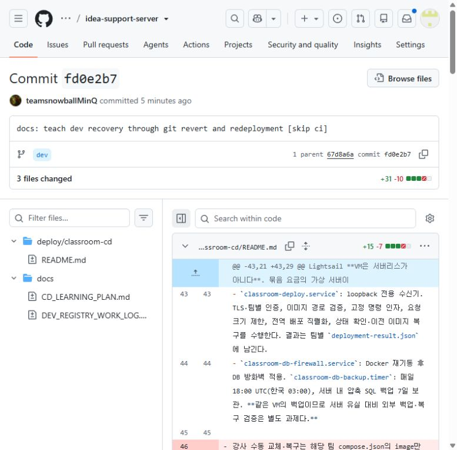

# GitHub 웹에서 PR을 되돌려 dev에 다시 배포하기

학생은 GitHub 웹과 자기 팀 health 주소로 실습한다. 터미널·Python·SSH는 필요하지 않다.

## BAD_COMMIT_SHA에는 정확히 무엇을 넣나요?

`BAD_COMMIT_SHA`는 **되돌릴 변경을 만든 커밋의 SHA를 넣으라는 자리표시자**다. SHA는 커밋마다 붙는 식별 번호다. 정상 상태로 돌아가고 싶은 시점의 커밋을 무조건 선택하는 방식이 아니라, **취소할 변경이 들어 있는 커밋**을 찾는다.

실제로 존재하는 이 저장소의 예시:

| 항목 | 실제 값 |
| --- | --- |
| 전체 SHA | `fd0e2b707be3c7d768b4ca04dbf7e0129b575f80` |
| 화면의 짧은 표시 | `fd0e2b7` |
| 변경 내용 | 복구 강의 문서를 Git Revert 방식으로 수정한 커밋 |
| 직접 확인 | [실제 GitHub 커밋 화면](https://github.com/MinQDU014/idea-support-server/commit/fd0e2b707be3c7d768b4ca04dbf7e0129b575f80) |

이 문서 커밋을 취소한다고 가정하면 `BAD_COMMIT_SHA` 자리에 위 **40자리 전체 번호**를 넣는다는 뜻이다. 이 번호는 SHA를 읽는 **설명용 예시**이며 학생이 실제로 되돌릴 대상은 자기 팀의 실습 PR이다. 예시 문서 커밋에는 `[skip ci]`가 있어 재배포 실습 대상으로 쓰지 않는다.

SHA 확인 순서: **Code → 브랜치 dev → Commits → 커밋 제목 → Copy full SHA 아이콘**. 커밋 주소의 마지막 부분도 전체 SHA다. 위 화면은 실제 예시 저장소의 화면이다.

## 준비: dev에 합쳐진 실습 PR 한 개

2026-11-11 확인 시 예시 저장소에는 merged PR이 없다. 현재 커밋은 직접 push한 기록이므로 바로 누를 PR Revert 버튼은 없다. 학생 저장소에서 다음 준비를 먼저 한다. 이미 dev에 합쳐진 실습 PR이 있으면 바로 다음 절로 넘어간다.

1. **Code** 탭에서 브랜치를 **dev**로 고른다.
2. `README.md`를 열고 연필 **Edit this file**을 누른다. 실습 문장 한 줄을 추가한다.
3. **Commit changes…**에서 새 브랜치에 커밋하는 옵션을 선택하고 `practice/rollback-demo` 같은 새 이름을 입력한다. **Propose changes**로 진행한다. 커밋 메시지에는 `[skip ci]`를 넣지 않는다.
4. PR 화면에서 **base: dev**를 확인하고 **Create pull request**를 누른다.
5. 검사가 통과하면 **Merge pull request → Confirm merge**로 dev에 합친다. 이번 실습은 **Create a merge commit** 방식을 쓴다.
6. **Actions → Dev Registry**에서 최초 배포 완료를 확인한다. README 문장 실습은 앱 기능을 바꾸지 않으므로, 파일 내용과 Actions 실행 기록으로 변경·복구를 확인한다.

## 화면 순서대로 따라 하기

| 순서 | 학생이 누를 곳 | 화면에서 확인할 내용 |
| --- | --- | --- |
| 1 | 저장소 **Pull requests → Closed** | 되돌릴 실습 PR을 연다. 상태가 **Merged**인지 본다. 단순 Closed는 합쳐진 PR이 아니다. |
| 2 | PR의 **Conversation** | 본문 아래 merge 기록에서 **into dev**인지 확인한다. **Files changed**로 취소할 변경도 확인한다. |
| 3 | merge 기록의 커밋 번호 | 이 번호를 누르면 전체 merge SHA를 볼 수 있다. 웹 Revert에서는 SHA를 입력하지 않고 원래 PR을 선택한다. |
| 4 | 원래 PR 아래쪽의 **Revert** | 변경을 취소하는 복구 PR을 준비한다. 이 버튼만 눌렀을 때는 아직 dev가 바뀌지 않는다. |
| 5 | 복구 PR의 **base: dev**와 **Files changed** | 원래 추가했던 문장이 삭제되는 등 변경이 반대로 만들어졌는지 확인한 뒤 **Create pull request**를 누른다. |
| 6 | 복구 PR의 **Checks** | 검사 통과를 기다린다. 현재 workflow는 PR에서 검사만 하고 앱 배포는 하지 않는다. |
| 7 | **Merge pull request → Confirm merge** | 복구 PR이 dev에 반영된다. 새 복구 커밋이 생기며 원래 기록도 남는다. |
| 8 | **Actions → Dev Registry → 새 실행** | Branch가 **dev**이고 복구 후 새 커밋의 실행인지 본다. **Dev Lint and Test**, **Push dev image to Registry**, 마지막 **Deploy team app and check health**가 모두 성공해야 한다. |
| 9 | 브라우저의 자기 팀 health 주소 | 1팀은 [health 확인](https://daelim.minq.live/team1/common/health). `status: ok`, `database: up`과 실제 복구할 변경을 확인한다. README 실습은 GitHub의 dev 파일에서 문장이 사라졌는지도 확인한다. |

### Revert 버튼은 어디에 있나요?

출처: [GitHub 공식 PR 되돌리기 안내](https://docs.github.com/en/pull-requests/how-tos/merge-and-close-pull-requests/reverting-a-pull-request). **위 이미지는 버튼 위치를 설명하는 GitHub 공식 예시이며 우리 저장소의 PR 화면은 아니다.** 자기 팀 PR에서 대상이 dev인지 확인한다.

### Merge 버튼 확인

출처: [GitHub 공식 PR 합치기 안내](https://docs.github.com/en/pull-requests/how-tos/merge-and-close-pull-requests/merging-a-pull-request). 이미지의 저장소·브랜치는 공식 예시다. 학생은 자기 복구 PR에서 **base: dev**를 확인한다.

## 결과를 기록하기

원래 PR 번호·취소할 변경의 SHA, 복구 PR 번호·dev 반영 후 새 SHA, Actions 실행 URL, health 결과를 적는다. `latest`는 복구 후 새 이미지로 갱신되고 `dev-새커밋SHA` 태그도 생긴다. 새로 빌드한 복구 이미지의 digest가 옛 이미지와 같다고 가정하지 않는다.

Revert 버튼이 없으면 저장소 쓰기 권한, 원래 PR의 Merged 상태, 충돌 여부를 확인한다. dev에 직접 push한 커밋에는 이 PR 경로를 그대로 적용할 수 없으므로 먼저 위 실습 PR을 준비한다. 코드 복구만으로 DB 스키마나 데이터가 되돌아가지는 않는다.

공식 근거: [웹에서 파일 수정·새 브랜치 만들기](https://docs.github.com/en/repositories/working-with-files/managing-files/editing-files), [PR 되돌리기](https://docs.github.com/en/pull-requests/how-tos/merge-and-close-pull-requests/reverting-a-pull-request), [PR 합치기](https://docs.github.com/en/pull-requests/how-tos/merge-and-close-pull-requests/merging-a-pull-request), [skip ci의 동작](https://docs.github.com/en/actions/how-tos/manage-workflow-runs/skip-workflow-runs).

업데이트 위치: 11주차 Notion의 활동 STEP 2 → 5·6번과 이 안내. 이 자료에서는 실제 PR 생성·Merge·Revert 또는 운영 서버 배포를 대신 실행하지 않았다.
