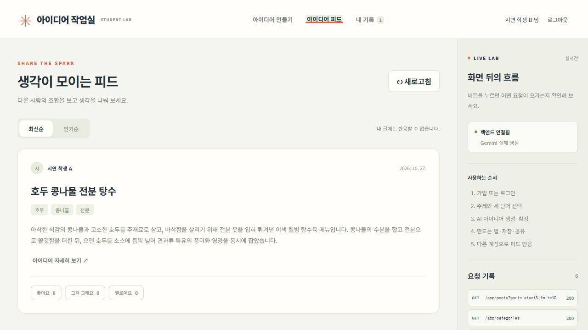

# 테스트와 학생 시연 화면

2026-10-28: 최신 후속 기능은 [분야별 가이드](CATEGORY_GUIDES.md)를 따른다. 아래 2026-10-27 음식 전용 회귀 기록은 당시의 변경 이력이다. 현재는 비음식도 구현 가이드·공모전 기획안·실행 계획을 제공한다.

최신 분야별 가이드 변경 검증: 백엔드 185개·React 32개 통과. 요청 범위에 맞춰 기존 별도 테스트 DB를 명시해 백엔드 `build -x demoBuild`를 검증했으며, 빌드 스크립트의 환경 문제 수정은 이번 작업에 포함하지 않았다.

## 2026-10-27 작업 범위

- 작업 전 현재 작업 기록, API 명세, 기존 테스트, 빌드·실행 규칙과 경로별 최근 커밋을 확인했다. 이 폴더의 독립 Git 이력과 최근 변경 Markdown은 없다.
- 기존 테스트 16개에 기능별 단위·API 통합·실패 회귀 테스트를 보강한다.
- Red → Green → Refactor 과정에서 발견한 문제와 실제 실패·성공 실행 결과를 이 문서에 기록한다. 기존 기능이 이미 통과하는 테스트를 소급해 TDD로 만들었다고 표현하지 않는다.
- 빌드에서 테스트별 성공·실패·건너뜀과 합계, HTML/XML 결과를 표시하고 실패 시 빌드도 실패하게 한다.
- 별도 `demo-web` React 화면으로 회원·카테고리·단어·생성·만드는 법·기록·공유·피드·반응을 직접 시연한다.
- 테스트는 실제 Gemini 비용이 들지 않는 mock AI와 별도 MySQL 테스트 DB를 사용한다. 시연 페이지는 실행 중인 실제 서버를 연결한다.
- 기기 연결·설치는 사용자 지시대로 생략한다. 백엔드·프론트·문서의 변경 위치와 최종 검증 결과를 완료 후 덧붙인다.

## 전체 빌드와 테스트

프로젝트 루트에서 아래 한 번으로 **Kotlin 컴파일 → 백엔드 테스트 → React 테스트·빌드 → 코드 스타일 검사 → JAR**을 검증한다. 독립 작업은 Gradle이 병렬 실행할 수 있다.

```powershell
.\scripts\build.ps1
```

일반 Gradle 명령에도 같은 검증이 연결되어 있다. Windows에서는 위 스크립트가 Java 임시 경로까지 설정한다.

```powershell
.\gradlew.bat build --console=plain
```

- 테스트별 `PASSED`, `FAILED`, `SKIPPED`와 마지막 `TEST RESULT` 합계를 출력한다.
- HTTP 오류를 기대하는 부정 테스트가 의도대로 동작하면 그 테스트는 `PASSED`다. 예상과 다르면 `FAILED`이며 빌드 종료값도 0이 아니다.
- 실패를 무시하지 않고, 첫 실패 이후의 테스트도 실행해 전체 실패를 보여 준다.
- 매 빌드에서 테스트를 실제로 다시 실행한다. 이전 결과를 `UP-TO-DATE`로 생략하지 않는다.
- `check`에 React 테스트와 Vite 빌드를 연결했다. React 테스트 실패도 전체 Gradle 빌드를 실패시킨다.
- 학생 업무 API 패키지(`main/app`, 차단된 dev 도구 제외)는 라인 95%·분기 80% 커버리지 미만이면 빌드를 실패시킨다. DTO·기존 기반 코드 전체를 이 수치에 포함한 것은 아니다. 전체 수치는 별도 JaCoCo 보고서로 확인한다.
- npm 의존성은 `package-lock.json`에 고정한다. 의존성이 바뀌어 다시 설치할 때는 Windows 파일 잠금을 피하도록 실행 중인 데모 서버를 먼저 닫는다.

| 결과 | 위치 |
| --- | --- |
| 백엔드 테스트 HTML | `build/reports/tests/test/index.html` |
| 백엔드 JUnit XML | `build/test-results/test/TEST-*.xml` |
| 백엔드 JaCoCo 커버리지 | `build/reports/jacoco/test/html/index.html` |
| JaCoCo XML | `build/reports/jacoco/test/jacocoTestReport.xml` |
| React JUnit XML | `demo-web/test-results/junit.xml` |
| 실행 JAR | `build/libs/idea-support-server-0.0.1-SNAPSHOT.jar` |
| 별도 React 배포 파일 | `demo-web/dist` |

## MySQL 테스트 DB

업무 통합 테스트는 **실제 MySQL 8**의 별도 DB에서 마이그레이션·시드·FK·트랜잭션·쿼리를 검증한다. 테스트 AI는 mock이며 실제 Gemini 키나 과금 호출을 사용하지 않는다. Gemini 어댑터는 HTTP 경계를 대체해 오류·응답 해석을 검사한다.

- 이 Windows PC는 `scripts/prepare-test-db.ps1`이 프로젝트 전용 `.local/mysql-test`, 포트 `33307`, DB `idea_support_test`를 준비한다. 일반 실행 DB `33306/idea_support`와 분리된다.
- 포트가 다른 프로세스의 것이면 수정하지 않고 실패한다. 이미 있는 테스트 데이터에 대응하는 비밀 설정이 없을 때도 임의 초기화하지 않는다.
- 자동 생성 비밀값은 Git 제외 파일 `.local/mysql-test-access.json`에만 둔다. 명령행·문서에는 비밀번호를 출력하지 않는다.
- 실제 `.env`는 테스트 설정에서 가져오지 않는다. 기존 회원·저장소 기반 테스트 일부는 H2를 사용하며, 업무 통합 테스트는 MySQL을 사용한다.
- 통합 테스트는 누락된 DB 때문에 조용히 건너뛰지 않는다. DB 준비가 안 되면 빌드를 실패시킨다.
- 테스트 URL의 DB 이름은 `_test`로 끝나야 한다. 통합 테스트의 데이터 정리 직전에도 실제 접속 DB 이름을 다시 확인한다.

다른 PC/CI에서는 먼저 **폐기 가능한 테스트 전용 MySQL DB**와 계정을 만들고 설정한다. 해당 DB의 업무 행은 테스트 전 정리된다.

```powershell
$env:IDEA_TEST_JDBC_URL = 'jdbc:mysql://127.0.0.1:3306/idea_support_test?connectionTimeZone=UTC&forceConnectionTimeZoneToSession=true'
$env:IDEA_TEST_DB_USER = 'YOUR_TEST_USER'
$env:IDEA_TEST_DB_PASSWORD = 'YOUR_TEST_PASSWORD'
.\scripts\build.ps1
```

## 테스트 범위

| 기능 | 검사하는 동작 | 대표 테스트 |
| --- | --- | --- |
| 회원·JWT | 가입, 중복, 비밀번호 해시, 잘못된 로그인, 프로필, 갱신, 토큰 용도·서명·만료·회원 존재 | `JwtTest`, `UserControllerSpec`, `DomainApiTest` |
| 카테고리 | 시드 수, 조회, 미리보기 비저장, 정규화 중복 재사용, 생성, 후보 부족 | `IdeaApiIntegrationTest`, `DomainApiTest`, `ContentPolicyTest` |
| 단어 | 3개 추출, 순서, 중복·외부 ID, 최대 2개 고정, 이전 단어 회피·부족 시 재사용, 방향성 | `WordComponentTest`, `DomainApiTest` |
| 의미 매칭 | 키워드 우선, mock 한계, AI 후보 ID 검증, 캐시·TTL·후보 내용 변경 | `WordMatchTest` |
| 아이디어 | AI 결과 검증, 순서와 무관한 조합 캐시, 모델 버전, 재조합, 실패 미저장·회복, 동시 1회 생성 | `IdeaGenerationTest`, `GenerationCoordinatorTest`, `IdeaApiIntegrationTest` |
| 분야별 후속 가이드 | 네 유형의 생성·공유·캐시·사용자 유형 저장, 기존 경로 호환, 잘못된 유형/출력 거절, 음식의 조리 불가 | `GuideApiTest`, `GuideGenerationTest`, `RecipeGenerationTest`, `RecipeScopeApiTest`, React `guide-scope.test.jsx` |
| Gemini 경계 | JSON 구조, 완료 상태, thought 제외, 잘못된 응답, HTTP 429/401/500, 시간 초과, 네트워크 오류, 재시도 | `GeminiAiClientTest` |
| 공유·피드 | 공개 HTML, 이스케이프, 링크와 피드 구분, 중복 게시 재사용, 최신·인기 커서, 숨김 제외 | `ShareHtmlTest`, `IdeaApiIntegrationTest`, `DomainApiTest` |
| 반응 | 좋아요·변경·명시적 null 취소, 반복 요청, 내 글 금지, 링크 글 금지, 없는 글 | `IdeaApiIntegrationTest`, `DomainApiTest`, React `App.test.jsx` |
| 공통 | 전 업무 경로 인증, 입력 JSON, 상태 코드·오류 본문, 호출 제한·Retry-After·IP 예산, health, CORS, 개발 경로 차단 | `ErrorContractTest`, `RequestLimitTest`, `HealthTest`, `DomainApiTest` |
| React | 버튼 활성 조건, 고정 개수, 생성·확정·만드는 법·기록, 실패 시 선택 유지, 내 글 반응 차단, 취소, 자동 토큰 갱신·동시 갱신, 비밀값 미표시 | `api.test.js`, `App.test.jsx` |
| 로컬 기록·프록시 | 전체 스냅샷, 중복 갱신, 50개 제한, 잘못된 저장값, 삭제, React 소스와 공유 URL 라우팅 | `storage.test.js`, `vite-config.test.js` |

## 실제 Red → Green → Refactor 기록

기존 구현에 테스트를 추가했으므로 모든 코드를 처음부터 TDD로 작성했다고 주장하지 않는다. 실제 결함에는 **실패 테스트 실행을 먼저 확인하고** 수정·리팩터링했다.

| 순환 | Red: 실제 실패 | Green: 수정 후 | Refactor |
| --- | --- | --- | --- |
| 만드는 법 문자열 검사 | `RecipeGenerationTest` 21개 중 2개 실패, 종료값 1. 재료 수량·단계 제목의 내용 검사 누락 | 21개 모두 통과 | 검사 대상 문자열을 한 목록으로 모아 기존 공통 정책에 전달 |
| React API 클라이언트 | 테스트를 먼저 추가한 상태에서 미구현 모듈로 실행 실패, 종료값 1 | 자동 갱신·중복 갱신 방지·오류·로그 비밀값 검사 10개 통과 | 통신·세션 갱신·화면 표시 책임 분리 |
| 로컬 브라우저 Origin | 실제 클릭에서 가입 403. 전용 CORS 회귀 테스트도 expected 200 / actual 403으로 실패 | `127.0.0.1:5173` 명시 허용 후 통과. 미등록 Origin은 계속 403 | 기본 Origin은 application YAML 한 곳에서 정의 |
| React 개발 서버 경로 | `/s` 프록시가 `/src/main.jsx`까지 백엔드로 보내 빈 화면. 경로 회귀 테스트 실패, 종료값 1 | 경계를 `/s/`로 고쳐 React 소스 200 및 테스트 통과 | 프록시 경로 목록을 별도 모듈로 분리 |
| 음식 전용 범위 | 서버 회귀 25개 중 5개 실패, React 4개 중 3개 실패. 비음식 실행 계획의 생성·캐시·표시를 허용하던 문제 | 수정 후 서버 회귀 25개와 React 27개 통과, 전체 빌드 백엔드 148개·React 27개 통과 | 카테고리 자격 정책을 컴포넌트로 모으고 DTO `supportsRecipe`로 UI와 공유 화면의 판단 통일 |

개발 중 전체 빌드에서 실제 테스트 실패가 `TEST RESULT: FAILURE`와 `BUILD FAILED`를 발생시키는 것도 확인했다. 실패 증거 원본은 `.local/red-recipe.log`, `.local/red-cors.log`, `.local/red-proxy.log`에 보관한다. 최종 정상 빌드 결과로 테스트 리포트를 덮어쓰므로, 위 표에 원인과 종료값을 남겼다.

한 테스트만 반복할 때:

```powershell
.\gradlew.bat test --tests '*RecipeGenerationTest' --console=plain
cd demo-web
npm run test:watch
```

새 기능도 먼저 동작 기대를 테스트로 추가해 실패를 보고, 최소 수정으로 통과시키고, 통과 상태를 유지하며 중복을 정리한다. 통과한 기존 코드에 고의 실패를 상시 남겨 정상 빌드를 깨뜨리지는 않는다.

## 학생 시연 방법

서로 다른 창에서 실행한다.

```powershell
# 백엔드 8080, 일반 MySQL 33306
.\scripts\start-local.ps1
```

```powershell
# 별도 React 화면 5173
.\scripts\start-demo.ps1
```

[실습 화면](http://127.0.0.1:5173/)에서 회원가입 → 주제 선택 → 단어 뽑기·고정 → 생성 → 확정 → 만드는 법 → 내 기록 → 공유 → 피드 순으로 시연한다. 다른 회원으로 로그인하면 첫 회원의 글에 반응·변경·취소를 할 수 있다. 내 글의 반응 버튼은 비활성화된다.

오른쪽 **LIVE LAB**은 실제 요청 경로·HTTP 상태·소요 시간·업무 응답을 보여 준다. 회원 API의 응답은 가리고 비밀번호·토큰·Authorization 헤더는 출력하지 않는다. 키는 브라우저에 넣지 않으며 AI 호출은 백엔드가 한다.

회원 토큰은 sessionStorage, 내 기록은 localStorage에 저장한다. 기록은 브라우저에 종속되며 서버 동기화 기능이 아니다. 링크 공유를 다른 PC에서 열려면 백엔드의 `SERVER_PUBLIC_URL`과 접근 가능한 주소를 설정해야 한다. 생성 대기 취소는 외부 AI 실행이나 과금의 즉시 취소를 보장하지 않는다.

## 결과와 업데이트 위치

2026-10-27 음식 전용 수정 후 검증 결과: **백엔드 148개·React 27개, 총 175개 통과. 실패·건너뜀 0.** 학생의 기존 프론트 프로젝트를 수정한 것이 아니라, 이 저장소 안에 독립 실습용 React 페이지를 추가했다.

최종 `scripts/build.ps1` 실행은 **BUILD SUCCESSFUL (1분 12초), 종료값 0**이다. `jacocoTestCoverageVerification`, 코드 스타일 검사와 두 빌드도 통과했다. `scripts/start-demo.ps1`로 다시 시작해 최종 소스의 실제 화면을 확인했으며 백엔드는 DB up·Gemini·seedReady true다. 저장 기록은 실제 새로고침 뒤에도 유지됨을 확인했다.

JaCoCo 기준 학생 업무 패키지는 라인 **99.1% (534/539)**, 분기 **84.4% (233/276)**다. 전체 소스는 라인 **75.7% (1311/1732)**, 분기 **61.3% (356/581)**다. 테스트 개수나 라인 수치가 모든 경우의 완전한 검증을 뜻하지는 않는다. 실행하지 않는 기존 운영 기반 코드까지 100%라고 표현하지 않는다.

실제 브라우저에서는 회원 A의 가입·로그인, 단어 추출·고정·리롤, Gemini 생성·확정·만드는 법, 전체 기록 저장, 링크 생성, 피드 게시와 내 글 반응 비활성화를 확인했다. 회원 B로 좋아요 → 다른 반응으로 변경 → 같은 버튼으로 취소, 인기순 조회도 확인했다. 실제 생성은 5초 제한에서 504를 한 번 반환했으며 같은 입력을 유지한 재시도는 201로 성공했다. 실제 실패를 mock 결과로 숨기지 않았다.



API 8080·프로젝트 MySQL 33306·테스트 MySQL 33307·React 127.0.0.1:5173을 사용한다. 같은 PC의 다른 프로젝트가 IPv6 localhost의 5173을 사용하므로, 이번 데모는 링크에 적힌 **127.0.0.1** 주소로 접속한다. 다른 프로젝트 프로세스는 변경하지 않았다. 실제 기기 설치는 생략했다.

- 백엔드 테스트: `src/test/kotlin/com/ideasupport`.
- 테스트 프로필: `src/test/resources/application-test.yaml`.
- 빌드·리포트: `build.gradle.kts`, `scripts/build.ps1`, `scripts/test.ps1`, `scripts/prepare-test-db.ps1`.
- React 화면·컴포넌트·테스트: `demo-web/src`; 프록시: `demo-web/vite.config.js`, `demo-web/proxy-paths.js`.
- API 필드 변경 시 Swagger와 `docs/API_SPEC.md`, `docs/student-guide`도 함께 갱신한다.

설정 근거: [Gradle 테스트 로깅·실패 처리](https://docs.gradle.org/current/userguide/java_testing.html), [JaCoCo](https://docs.gradle.org/current/userguide/jacoco_plugin.html), [Vite](https://vite.dev/guide/), [React 프로젝트 연결](https://react.dev/learn/add-react-to-an-existing-project).
