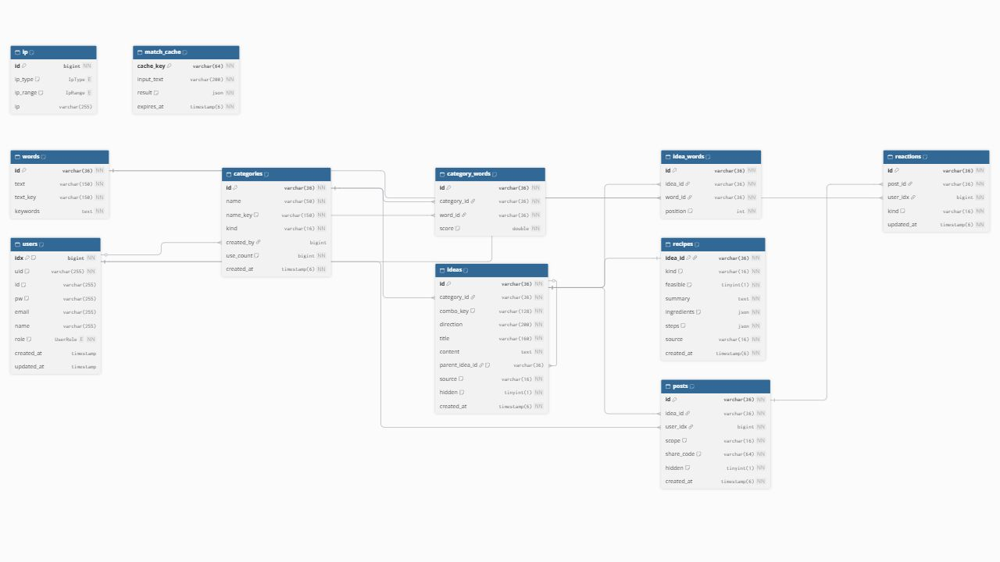

# MySQL 스키마와 온라인 관계도

2026-10-28: 분야별 가이드를 위해 v3 마이그레이션이 `categories.guide_type`을 추가한다. 수정용 DBML에는 이 컬럼을 반영했다. 아래 온라인 링크·이미지·JSON은 2026-10-27의 66컬럼 스냅샷이며, v3 적용 후에는 67컬럼이다. 이번 변경에서는 온라인 사이트를 수정하지 않았다.

기준일: 2026-10-27. 현재 프로젝트 MySQL의 실제 테이블·컬럼·인덱스·FK·CHECK와 대조한 구조다.

[온라인 관계도 열기](https://dbdiagram.io/embed#c=pako%3AeJytWG1PG0kS%2Fu5fUd8Mks8C7pI78YEV2mR1bF6WI4lWq2jlHTwNzGLPeGfGB9Yp0gRMxGKv1iR2MGTMGcWBIHmlwTbEObF%2FaLrnP5y658XzBmGj%2FWZPV1VXVz39VFXPy9KPKKuCwCMuoxQLBUlW4T8JAJ5TuUVOQRm1VEDTkHxQevSv%2B8kEwENJpf9Jo0xaA1yvk9cDwP0BOTKANM5IqwlWs0wOu8A0gOx0rI0OPtlOw9TE1G28VYbJCfKmDlN%2FJ61LIJUOaetgbVWptWEd8Gnd2tTwLwZpDayyQfY1wFWNHBlpsA6q5E0NAmtkzzB7BuCPZWxopvGStDSwfu1ajfdWo0lONCCNHdKqppOJZ4nEXbGYhycKkhekHGKnnL3zYO5hAuDJo7sLnsRc4XGp4Kzfv%2F%2FNtwmAO3cffudbX%2BDEZU%2FAVXetPUskHnOLOQRFBckKkxL4dVgUlgVRhaeF1RSIkgpiMZdLgSBmZZRHoso%2B0sDijQG%2B0NzDzt9LA3lRJXqbHNbgq3tkr0bKOpCNLjk4TX6fACgKPPybk7MrnDw2devWODwdWXdMfv3tY8DGrzA7Pwdkf%2BgzTyot3C%2BTwxozFWeJuXSkmx%2BGpDUEL%2BtMvrAWL28ODXI0gH8%2BmP0SSK%2BJj7u4pjs5wr1tqzkE03iZBvKmhrvDwAJ%2Bdwm4%2FHaUObYRynNCLrBXAkDk8ij8TaaJ9TLsiwSPlrhiTp2GJM0VM5qVEaciPsOpoAp5pKhcvkDjWeDjPgsij9aRnU4WqadFUfipiFLMj2lICjyzaickvFh0Vp%2BNLpCdAbN%2FCeSwRnoDoFkirSE5bqXhq3t4pw4OFObvUQDRyBBjSI4Mq9E0%2B22aTSpUFHi2xBBhNXRc6dhot0GY5VS0LMmC47ovxX%2B9PR5E4%2FfhoN6a8KHJXc2sopInMRkQ8QBn9s%2BxcUbPRu%2FuiyruDil88aszIO2G%2BUG39utWQweKpeNyGkhnF%2FfPARun5ERjgVoVxJGnk7dDfripWyw514rmTUGZrFQUVe%2BmxWR%2FwnORlM%2FM%2Fjl1AlfeUw4jF3VyoQM5qJPeb2Ad%2FJdsN6%2FEyVjYoyA8fP49dRCwtJpxUlHKUGJwwDJGD5oaOZ8CgaemHUytj5Qkmfe0vDyEceYuhMFmDg3cHzISsIFC00E%2BDqytqtlv4%2BNu2uczRRXZbJHymUMTNE2nBjhG%2FGpUlIaASgRxtybJ%2FM0gp6J19QpAucvXYI6BBZXs7Zipa%2FLi2QrHzV2IxK1%2Fbr04dyFivdTS3mYsSnuGOdDA7Glk82dycArWJmVKsLZ%2BoXVvZxiNi5fPmwfIUwkL%2BoWouWsFlKwkI%2BClIvUi7m5MRuPlGvWDeI157sLX51vKFR%2BP0t9PIxx72r4w%2ByHFKj6LN%2B0lcKWDqxqudJxKnwbT2KdFnvHgKftlkwdpa%2BTw3ajq4516KPS0x%2FkTI56V8otSEJlT%2F4hjw%2FjTATnZtRqn7E5i49R6%2FY5R0iXMzgHulUm7TM9P%2FlcjFR2sjQ6LGS%2FIKKsKkjgqfBORCyOouRGHT94Or2clUUWiGnNZCpyMRDXDesGYk7NWoNKh%2FtjRp4VoaOAj3aELWuXNnmH2L5nrb2qMLnyNIjuDIhXlrN%2FBuJgto7wgCoCbNXrP8lJ2lemuCDyPRFAFsSSI6tjk%2BKdYfvu9%2BVFj%2FDVwXdvXwOyf045qXwOrfolf6W5X1dbJ%2FvCzSd%2FDQxj%2B3opza%2Fzw8l0tFnd3zRENpSQsbS%2BHr9PsXCDqzsHTTtYomIAcdu1CYDcgXWfJzRm7a6RVBnOg4eNutK1gu9%2Bcwq6C1M3pqyApAgN%2BqLQ7ibZ2dYbLbZ0mcgJfaFbZgKnkjThNCHKa42zK2zOW0Oz4OxIR1euo0Iudl7fsCsquug7%2BMOaddRGpawiJMAGcyMPU%2BA%2Be11nmdWB7P5%2F6sk%2F2aqPm0OOeMm3BdXYD4iPHGvH%2BwBxo0eTLKCsUvIYyJrPh9F%2FdzXkJXJIk3r3uhRxnH2kJcYpAd4y%2F8O4lr3SsZhlMQ8M774DsdfGF3UQqxXyek0uxbcGyjHgBiaoCPyqSGGf1sIvfVl2XSEejY0r3Er5%2B9M1DwIZB9hw6U1HhaiOVjvX6Zze4EdVrmPDGJBSTctwvAz6p4lc6myJ6jXSQD6xGE280GTDOdVzVgCKDwsHu8%2ByTO5XK7JepEep6tJkpSIr6JxEA7Ykz%2Fjk51LsUPlUxcoK46mZrCSH7cikrnEw7a36kfftvV0wspqE7hQGeLNz3X5smQ8ChXZB%2Fr%2BNX%2Bh8pRp9ZTryA%2BIiKxjswPbDApBxPUr5tInMEU%2FXiEohMmKJGSxFac51K2SmJpTe2k7QmIjnDhK5iOTupgghjLHfJVJK5Nx5kOWYtaMdBPD55bj3vRmo5mL0qqehpoEZp4rwSD3hrSC70UYtIp2i6Jz6p%2BqRsQoxjPY61XjcDPPP7swF%2FA8LMCavI64%2FQivuTFxS6Yj8NxTxlfAbq3IMHkOecL8VcDSDNE2cDrRJRcLeIBU90rxjksOg4wFlFyVQyj1aSqaR79BCCPJNULf4VBlc%2BOrAxhxpgo0lauy4ppt3%2FuK%2BZvd%2FpxGEaZ6TSdp5hyIf39IWDMsTGb6QdA5w8p2ZXMlkuu2K%2FGbJfgcGBcVKEMsVCUc0EpuNosy8jpZhTryo%2FdDA9brGD2E9yTvmfu0OpLFyO0HpBkJHyR%2BDiU%2FEhwD4wWyvF9ab21Oy1Im1rs%2BVrzmnlelsFmgzjOe1BvcnO9yZmz0XRiiQU3Nv5ifdWdpYCe912HnztDzJ72nWeeNmn8Bvj6EmFRnRuHkh71%2FxwyaYH2mwPDWw0Ry%2FaabAa%2B3Q%2Boi%2FjjXNS6YK1X6fziNWq4eMya8BPnpP2rtN241rcCLuAliD8hjTte91L%2B96cZr6w357TAr%2FuKa55utOhR4i0fx6Z8dsUeJ86lY2out30jP3g49MQ1lijO%2B0bFdJuFzBjz%2BJBadu%2BT%2Foa2%2F5Jyda50Sl8M5OrFRqwZr6IuOYQFz0K63euOYVXn11Rj05nohnxeImKTo%2FKS9otHTPefhEVe4%2BRyvX70G7dlwy6Cn9xu3j3OIn%2FA9RAuOw%3D)

dbdiagram.io 편집기에 직접 작성하고 화면에서 관계도를 확인했다. 위 링크는 공식 [DBML-in-Link](https://docs.dbdiagram.io/dbml-in-link-diagram/) 기능을 이용하므로 로그인 없이 다시 볼 수 있다. 계정에 저장된 다이어그램은 아니며, 구조가 바뀌면 링크도 새로 만들어야 한다. 단축 링크가 아닌 전체 링크를 복사해 사용한다.

## 제공 파일

| 파일 | 용도 |
| --- | --- |
| [idea-support.dbml](idea-support.dbml) | 관계도의 수정 원본. 테이블·제약·인덱스·한국어 설명 포함 |
| [idea-support.schema.json](idea-support.schema.json) | 실제 MySQL에서 조회한 구조 메타데이터 스냅샷 |
| [online-diagram.url](online-diagram.url) | Windows에서 온라인 관계도를 여는 바로가기 |
| [idea-support-erd.png](idea-support-erd.png) | 실제 온라인 관계도 전체 화면 |
| [학생용 API 흐름](../student-guide/API_USER_FLOW.md) | 화면에서 API와 각 데이터를 사용하는 방법 |

## 관계를 읽는 순서

11개 테이블, 66개 컬럼, 12개 FK다. Liquibase 자체 관리 테이블인 `databasechangelog`, `databasechangeloglock`은 관계도에서 제외했다.

| 영역 | 테이블과 관계 |
| --- | --- |
| 자체 회원 인증 | `users.idx`는 내부 회원 PK, `users.uid`는 외부 회원 식별자다. |
| 카테고리와 단어 | `categories`와 `words`를 `category_words`가 연결한다. 하나의 단어가 여러 카테고리에 속할 수 있다. |
| 사용자 카테고리 | `categories.created_by`가 회원을 참조한다. 기본 카테고리는 null이다. |
| 생성 결과 | `ideas.category_id`가 카테고리를 참조한다. 선택한 3개 단어와 순서는 `idea_words`에 기록한다. |
| 재조합 | `ideas.parent_idea_id`가 원본 아이디어를 참조한다. 최초 결과는 null이다. |
| 만드는 법 | `recipes.idea_id`는 PK이자 FK다. 아이디어당 만드는 법은 0개 또는 1개다. |
| 공유와 피드 | `posts`가 아이디어와 작성 회원을 참조한다. `scope`로 link와 feed를 구분한다. |
| 반응 | `reactions`가 글과 회원을 참조한다. `(post_id, user_idx)`는 유일하므로 글당 회원 반응은 1개다. |
| 내부 기반 | `match_cache`는 의미 매칭 결과 캐시, `ip`는 기존 IP 제어용 테이블이다. |

## 구조가 바뀔 때 업데이트할 곳

1. 실제 DB 변경은 `src/main/resources/db` 아래에 새 Liquibase changeset을 추가한다. 이미 적용한 변경 이력을 고치지 않는다.
2. 변경 후 실제 MySQL과 대조하여 `idea-support.dbml`과 메타데이터 스냅샷을 갱신한다. DBML은 스키마 설명용이며 직접 실행하는 마이그레이션 파일이 아니다.
3. [dbdiagram.io 편집기](https://dbdiagram.io/d)에 DBML 전체를 붙여 넣고 오류·경고·관계를 확인한다. 계정 저장은 사이트 로그인이 필요하다.
4. 온라인 읽기 전용 링크를 새 DBML로 다시 생성하여 이 문서, `online-diagram.url`, API 흐름 안내의 링크와 관계도 이미지를 갱신한다. 링크 형식은 위 공식 문서를 따른다.
5. API 필드도 바뀌면 Swagger, `docs/API_SPEC.md`, `docs/student-guide/API_USER_FLOW.md`와 Word 문서를 함께 갱신한다.

관계도에는 DB 연결 주소·계정·비밀번호·Gemini 키·회원 행 데이터를 넣지 않았다. 링크를 받은 사람은 스키마 구조를 읽을 수 있다.
