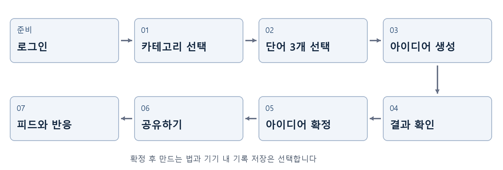

# 아이디어 보조 앱 API 연동 안내

기준일 2026년 10월 28일

MySQL과 기존 자체 회원 인증을 사용하는 현재 API 기준입니다.

## 01 전체 사용자 흐름

이 안내는 학생이 구현한 화면을 현재 백엔드에 연결할 때 사용하는 순서표입니다. 화면의 버튼이 어느 API를 부르는지, 응답에서 어떤 ID를 보관해야 하는지, 다음 화면에 무엇을 넘겨야 하는지를 설명합니다.



| 사용자 행동 | 주요 요청 | 다음 단계에 보관할 값 |
| --- | --- | --- |
| 로그인 | POST /app/user/login | accessToken, refreshToken |
| 카테고리 선택 | GET /app/categories | 선택한 category.id |
| 단어 선택과 리롤 | POST /app/words/draw | 선택한 words의 id 3개 |
| 창조 버튼 | POST /app/ideas | 응답 idea.id와 결과 전체 |
| 분야별 가이드 선택 | POST /app/ideas/{id}/guide | guide 전체 |
| 링크 또는 피드 공유 | POST /app/shares 또는 /app/posts | shareUrl 또는 postId |
| 피드 평가 | PUT /app/posts/{id}/reaction | myReaction과 reactions |

기본 주소는 http://localhost:8080입니다. 요청 본문은 JSON이며 업무 API에는 Authorization: Bearer <accessToken>을 보냅니다. 로그인 단계는 기존 자체 인증을 사용합니다.

중요한 구분은 categoryId → wordIds → ideaId → postId입니다. 이름이나 단어의 표시 문자열을 ID 대신 보내지 않습니다.

## 02 로그인과 토큰 관리

먼저 회원을 만들고 로그인합니다. 이미 가입한 사용자는 로그인부터 시작합니다. 회원가입 성공만으로 토큰이 발급되지는 않습니다.

`POST /app/user/sign-up`

```json
{
  "id": "student01",
  "pw": "DEMO_PASSWORD",
  "email": "student@example.com",
  "name": "학생1",
  "birth": "2000-01-01"
}
```

현재 가입 입력에는 id, pw, email, name, birth가 필수입니다. birth는 입력 DTO에서 필수지만 현재 회원 테이블에는 저장하지 않습니다.

`POST /app/user/login`

```json
{
  "id": "student01",
  "pw": "DEMO_PASSWORD"
}
```

```json
{
  "accessToken": "ACCESS_TOKEN",
  "refreshToken": "REFRESH_TOKEN"
}
```

| 사용할 값 | 사용처 |
| --- | --- |
| accessToken | 카테고리, 단어, 생성, 피드 등 업무 요청의 Bearer 헤더 |
| refreshToken | POST /app/user/refresh-token의 본문에만 사용 |

### 토큰이 만료된 경우

업무 요청이 401이면 refresh-token에 {"refreshToken":"..."}을 보내고, 받은 새 accessToken으로 원래 요청을 한 번만 다시 보냅니다. 갱신도 실패하면 로그인 화면으로 이동합니다. 로그인 요청 자체에서 갱신을 반복하지 않습니다.

GET /app/user/profile은 현재 로그인한 회원의 정보입니다. 일반 USER도 자기 정보를 조회할 수 있습니다. 실제 비밀번호나 토큰을 화면 로그에 출력하지 않습니다.

## 03 카테고리 선택과 추가

화면 01에 들어오면 목록을 받아 기본 카테고리와 다른 사용자가 만든 카테고리를 표시합니다. 사용자가 카드를 누르면 해당 객체의 id를 categoryId로 보관합니다.

`GET /app/categories`

```json
{
  "items": [
    {
      "id": "aa88393f-142f-5803-a920-3ade6082bbb4",
      "name": "음식 개발",
      "kind": "default",
      "wordCount": 149,
      "useCount": 12
    }
  ]
}
```

### 나만의 카테고리 화면 01 1

| 순서 | 사용자 행동 | 요청과 처리 |
| --- | --- | --- |
| 1 | 이름 입력 후 잠시 멈춤 | POST /app/categories/preview에 {"name":"건강 관리"} 전송 |
| 2 | 미리보기 확인 | matchedWordCount, words, canCreate 표시 |
| 3 | 이미 있는 이름 선택 | existingCategoryId가 있으면 그 ID로 이동 |
| 4 | 추가하고 시작 클릭 | POST /app/categories에 같은 name 전송 |
| 5 | 단어 선택 화면으로 이동 | 응답 category.id를 categoryId로 전달 |

preview는 조회용이고 실제 생성은 POST /app/categories입니다. 미리보기에서 받은 단어 일부를 그대로 추출 결과로 취급하지 않습니다.

같은 이름이 있으면 200과 created:false로 재사용합니다. 새로 만들면 201과 created:true입니다. 연관 단어가 10개 미만이면 422를 안내하고 이름을 수정하도록 합니다.

입력 중에는 디바운스를 적용하고, 이전 입력의 늦은 응답이 새 입력의 미리보기를 덮어쓰지 않게 합니다.

## 04 단어 선택과 다시 뽑기

화면 02는 같은 API로 첫 추출, 리롤, 단어 고정, 방향성 변경을 처리합니다. 단어는 text로 보여 주고 id로 요청합니다.

`POST /app/words/draw`

```json
{
  "categoryId": "aa88393f-142f-5803-a920-3ade6082bbb4",
  "lockedWordIds": [],
  "previousWordIds": [],
  "direction": ""
}
```

| 상황 | 요청할 값 | 화면 처리 |
| --- | --- | --- |
| 첫 추출 | 고정과 이전 단어는 빈 배열 | 응답 words 3개를 표시 |
| 다시 뽑기 | 직전 3개 ID를 previousWordIds로 전달 | 받은 3개로 화면 교체 |
| 단어 고정 | 고정한 0~2개 ID를 lockedWordIds로 전달 | locked:true를 고정 상태로 표시 |
| 방향성 변경 | direction에 200자 이내 문장 전달 | 새 방향으로 다시 뽑은 뒤 창조 가능 |

### 프론트에서 유지할 상태

- categoryId와 선택한 카테고리 이름
- words 전체와 각 단어의 id 및 text
- lockedWordIds 최대 2개와 현재 direction

중복 ID, 없는 단어, 다른 카테고리의 단어를 고정하면 400입니다. 후보 부족은 422이며 방향을 넓히거나 고정을 풀도록 안내합니다.

창조 버튼을 누를 때는 고정 여부와 관계없이 현재 화면의 단어 ID 세 개 모두를 POST /app/ideas에 보냅니다. 카테고리를 바꾸면 이전 선택 단어와 결과 ID를 비웁니다.

## 05 아이디어 생성과 결과 확인

화면 02의 창조 버튼이 요청을 시작하고 화면 03에서 기다립니다. 성공 응답을 받으면 화면 04로 이동합니다. 생성 중에는 버튼 중복 클릭을 막습니다.

`POST /app/ideas`

```json
{
  "categoryId": "aa88393f-142f-5803-a920-3ade6082bbb4",
  "wordIds": [
    "1fd8d6ed-af7c-54d6-9679-04950118d26f",
    "7e9865ba-d219-558a-b2e0-9fb258aa1d7b",
    "dc7c6955-03b5-5bda-8a15-9e22834d4c05"
  ],
  "direction": "간편하고 매콤한 캠핑 요리"
}
```

| 응답 값 | 뜻 | 프론트 처리 |
| --- | --- | --- |
| idea.id | 생성되거나 재사용한 결과 ID | 다음 화면에 ideaId로 전달 |
| idea.title, content, words | 화면에 표시할 결과 | 응답 내용으로 결과 화면 구성 |
| cached | 저장된 같은 조합 재사용 여부 | true여도 정상 성공으로 처리 |
| idea.source | gemini 또는 mock | mock이면 시연 예시임을 표시 |

### 같은 단어로 다른 결과를 받고 싶은 경우

`POST /app/ideas/{ideaId}/recombine`

본문 없이 호출합니다. 새 응답의 idea.id로 현재 결과를 바꾸고 parentIdeaId로 원본을 확인할 수 있습니다. 일반 POST /ideas를 반복하면 같은 결과가 재사용되므로 새 변형에는 recombine을 사용합니다.

`GET /app/ideas/{ideaId}`

새로고침이나 피드에서 결과 화면을 복원할 때 사용합니다. 생성 호출은 하지 않습니다. 취소 버튼은 프론트 대기를 중단하고 늦게 온 결과를 무시하게 하며, 서버의 외부 생성과 과금이 즉시 취소된다고 보장하지 않습니다.

## 06 확정과 만드는 법 그리고 기록

마음에 드는 결과를 확정하면 화면 05로 이동합니다. 확정 자체는 프론트의 화면 상태이며 별도의 확정 API는 없습니다.

### 분야별 후속 가이드

`POST /app/ideas/{ideaId}/guide`

버튼을 숨기지 않습니다. `idea.guideLabel`에 ‘보기’를 붙입니다. 음식은 만드는 법, 프로그램은 구현 가이드, 공모전은 공모전 기획안, 일반 분야는 실행 계획입니다. 직접 만든 카테고리는 추가할 때 후속 가이드 유형을 선택하며 기본값은 general입니다.

본문 없이 호출하며 새 생성은 201, 재사용은 200/cached:true입니다. 응답 `guide`의 summary, requirements(name/detail), steps(order/title/description)를 표시합니다. requirementsLabel은 재료·개발 준비·기획 준비·필요한 것을 구분합니다. `feasible:false`면 summary의 이유와 빈 목록을 표시합니다.

기존 `/recipe`도 모든 분야를 처리하는 호환 경로지만 신규 화면은 `/guide`를 사용합니다. 기존 supportsRecipe는 음식 여부이며 비음식 후속 버튼을 숨기는 조건이 아닙니다. 예전 타입 없는 plan은 버튼을 눌렀을 때 현재 유형으로 다시 생성합니다. 상세 계약은 [분야별 가이드 안내](../CATEGORY_GUIDES.md)를 참고하세요.

### 기록 탭에 저장하기

저장 버튼은 서버 API를 부르지 않습니다. 웹은 localStorage, 앱은 SQLite에 결과 스냅샷을 보관합니다. ideaId, 제목, 설명, 단어, direction, 있으면 guide, 저장 시각을 함께 둡니다.

기록 목록은 로컬 데이터로 표시합니다. 서버 결과가 404가 되어도 저장한 텍스트를 읽을 수 있도록 ID만 저장하지 않습니다.

## 07 링크 공유와 피드 게시

화면 06의 링크 복사와 피드에 올리기는 서로 다른 요청입니다. 둘 모두 결과의 ideaId를 본문에 넣습니다.

| 버튼 | 요청 | 공개 방식 |
| --- | --- | --- |
| 링크 복사 | POST /app/shares | scope:link. 피드에는 나타나지 않음 |
| 피드에 올리기 | POST /app/posts | scope:feed. 피드 목록에서 보임 |

```json
{
  "ideaId": "현재 결과 응답의 idea.id"
}
```

### 응답에서 사용할 값

```json
{
  "postId": "생성된 공유 글 ID",
  "scope": "link",
  "shareCode": "임의 공유 코드",
  "shareUrl": "http://localhost:8080/s/공유코드",
  "created": true
}
```

링크 복사는 shareUrl을 클립보드에 넣습니다. 피드 게시 후에는 피드 목록을 다시 받아 새 글을 표시합니다. 최초 생성은 201, 같은 회원과 결과와 scope의 재요청은 200과 created:false입니다.

`GET /s/{shareCode}`

로그인 없이 읽는 HTML 페이지입니다. 웹 브라우저로 열며 JSON API로 처리하지 않습니다. 방문자가 열었다고 새로운 AI 생성이나 만드는 법 호출이 발생하지 않습니다.

shareUrl의 localhost는 현재 서버 PC를 뜻합니다. 다른 PC에서 공유하려면 접근 가능한 서버 주소를 SERVER_PUBLIC_URL에 설정해야 합니다.

같은 아이디어라도 link 글과 feed 글의 postId는 다릅니다. 반응에는 피드 글의 ID를 사용합니다.

## 08 피드 목록과 반응 처리

`GET /app/posts?sort=latest&limit=20`

화면 07에 들어오면 최신순을 조회합니다. 인기순은 sort=popular입니다. 목록은 items이며 각 글에 isMine, myReaction, reactions가 포함됩니다.

| 응답 값 | 프론트 사용 |
| --- | --- |
| items[].id | 반응 요청에 넣는 postId |
| items[].ideaId | 결과 상세 GET /app/ideas/{id}에 사용 |
| isMine | 내 글이면 반응 버튼 비활성화 |
| myReaction | 현재 선택한 버튼의 상태 |
| reactions | like, meh, dislike 숫자를 그대로 표시 |
| nextCursor | 다음 페이지 요청에 그대로 전달. null이면 끝 |

`PUT /app/posts/{postId}/reaction`

| 사용자 행동 | 보낼 본문 |
| --- | --- |
| 좋아요 선택 | {"kind":"like"} |
| 그저그래요 선택 | {"kind":"meh"} |
| 별로예요 선택 | {"kind":"dislike"} |
| 현재 반응 취소 | {"kind":null} |

선택한 버튼을 다시 눌렀다면 프론트가 null을 보내야 취소됩니다. 같은 kind를 다시 보내면 반응 수는 늘지 않습니다. 숫자를 임의로 더하지 말고 응답 myReaction과 reactions로 교체합니다.

정렬을 바꾸면 커서를 비우고 첫 페이지를 다시 조회합니다. 인기순은 반응에 따라 이동할 수 있으므로 페이지를 붙일 때 글 ID로 중복을 제거합니다. limit은 1~50입니다.

## 09 오류 안내와 연동 확인

오류는 HTTP 상태와 JSON의 code, name, message로 처리합니다. 사용자에게는 message를 안내하고, 실패한 화면에서 선택한 카테고리와 단어를 유지하면 다시 시도하기 쉽습니다.

| 상태 | 주요 상황 | 화면에서 할 일 |
| --- | --- | --- |
| 400 | 형식 또는 단어 ID 오류 | 필수값과 현재 선택값 확인 |
| 401 | 토큰 누락 또는 만료 | 한 번 갱신 후 재시도. 실패하면 로그인 |
| 403 | 내 글에 반응 | 버튼 비활성화하고 안내 |
| 404 | 없는 결과 또는 숨김 | 목록으로 돌아가거나 로컬 기록 표시 |
| 422 | 연관 단어 부족 | 카테고리 이름 또는 방향을 넓히도록 안내 |
| 429 | 호출 제한 | Retry-After만큼 기다린 뒤 재시도 허용 |
| 502 또는 503 | AI 결과 또는 연결 문제 | 입력을 유지하고 재시도 버튼 표시 |
| 504 | AI 제한 시간 초과 | 로딩 종료 후 재시도 안내 |

### 학생 프로젝트에서 확인할 순서

- 회원 A로 로그인하고 카테고리 선택부터 생성까지 진행합니다.
- 같은 조합을 다시 요청해 cached:true를 확인합니다.
- 다시 조합하기의 결과 ID가 바뀌는지 확인합니다.
- 만드는 법을 두 번 열어 두 번째가 재사용되는지 확인합니다.
- 로컬 기록을 저장하고 새로고침 후 다시 표시합니다.
- 링크는 로그인 없는 브라우저에서도 읽히는지 확인합니다.
- 회원 B로 로그인해 회원 A의 피드 글에 반응하고 변경과 취소를 확인합니다.
- 카테고리와 방향성 변경 시 이전 요청 응답이 화면을 덮어쓰지 않는지 확인합니다.

서버 상태는 GET /common/health, 전체 계약은 Swagger와 docs/API_SPEC.md에서 확인합니다. 실제 Gemini 키는 서버 환경 파일에만 두며 프론트에 넣지 않습니다.

## 10 데이터 관계와 업데이트 위치

온라인 ERD는 현재 MySQL의 11개 업무 및 기반 테이블, 66개 컬럼, 12개 외래키를 반영합니다. Liquibase의 관리 테이블 두 개는 학생용 관계도에서 제외했습니다.

[온라인 MySQL 관계도 열기](https://dbdiagram.io/embed#c=pako%3AeJytWG1PG0kS%2Fu5fUd8Mks8C7pI78YEV2mR1bF6WI4lWq2jlHTwNzGLPeGfGB9Yp0gRMxGKv1iR2MGTMGcWBIHmlwTbEObF%2FaLrnP5y658XzBmGj%2FWZPV1VXVz39VFXPy9KPKKuCwCMuoxQLBUlW4T8JAJ5TuUVOQRm1VEDTkHxQevSv%2B8kEwENJpf9Jo0xaA1yvk9cDwP0BOTKANM5IqwlWs0wOu8A0gOx0rI0OPtlOw9TE1G28VYbJCfKmDlN%2FJ61LIJUOaetgbVWptWEd8Gnd2tTwLwZpDayyQfY1wFWNHBlpsA6q5E0NAmtkzzB7BuCPZWxopvGStDSwfu1ajfdWo0lONCCNHdKqppOJZ4nEXbGYhycKkhekHGKnnL3zYO5hAuDJo7sLnsRc4XGp4Kzfv%2F%2FNtwmAO3cffudbX%2BDEZU%2FAVXetPUskHnOLOQRFBckKkxL4dVgUlgVRhaeF1RSIkgpiMZdLgSBmZZRHoso%2B0sDijQG%2B0NzDzt9LA3lRJXqbHNbgq3tkr0bKOpCNLjk4TX6fACgKPPybk7MrnDw2devWODwdWXdMfv3tY8DGrzA7Pwdkf%2BgzTyot3C%2BTwxozFWeJuXSkmx%2BGpDUEL%2BtMvrAWL28ODXI0gH8%2BmP0SSK%2BJj7u4pjs5wr1tqzkE03iZBvKmhrvDwAJ%2Bdwm4%2FHaUObYRynNCLrBXAkDk8ij8TaaJ9TLsiwSPlrhiTp2GJM0VM5qVEaciPsOpoAp5pKhcvkDjWeDjPgsij9aRnU4WqadFUfipiFLMj2lICjyzaickvFh0Vp%2BNLpCdAbN%2FCeSwRnoDoFkirSE5bqXhq3t4pw4OFObvUQDRyBBjSI4Mq9E0%2B22aTSpUFHi2xBBhNXRc6dhot0GY5VS0LMmC47ovxX%2B9PR5E4%2FfhoN6a8KHJXc2sopInMRkQ8QBn9s%2BxcUbPRu%2FuiyruDil88aszIO2G%2BUG39utWQweKpeNyGkhnF%2FfPARun5ERjgVoVxJGnk7dDfripWyw514rmTUGZrFQUVe%2BmxWR%2FwnORlM%2FM%2Fjl1AlfeUw4jF3VyoQM5qJPeb2Ad%2FJdsN6%2FEyVjYoyA8fP49dRCwtJpxUlHKUGJwwDJGD5oaOZ8CgaemHUytj5Qkmfe0vDyEceYuhMFmDg3cHzISsIFC00E%2BDqytqtlv4%2BNu2uczRRXZbJHymUMTNE2nBjhG%2FGpUlIaASgRxtybJ%2FM0gp6J19QpAucvXYI6BBZXs7Zipa%2FLi2QrHzV2IxK1%2Fbr04dyFivdTS3mYsSnuGOdDA7Glk82dycArWJmVKsLZ%2BoXVvZxiNi5fPmwfIUwkL%2BoWouWsFlKwkI%2BClIvUi7m5MRuPlGvWDeI157sLX51vKFR%2BP0t9PIxx72r4w%2ByHFKj6LN%2B0lcKWDqxqudJxKnwbT2KdFnvHgKftlkwdpa%2BTw3ajq4516KPS0x%2FkTI56V8otSEJlT%2F4hjw%2FjTATnZtRqn7E5i49R6%2FY5R0iXMzgHulUm7TM9P%2FlcjFR2sjQ6LGS%2FIKKsKkjgqfBORCyOouRGHT94Or2clUUWiGnNZCpyMRDXDesGYk7NWoNKh%2FtjRp4VoaOAj3aELWuXNnmH2L5nrb2qMLnyNIjuDIhXlrN%2FBuJgto7wgCoCbNXrP8lJ2lemuCDyPRFAFsSSI6tjk%2BKdYfvu9%2BVFj%2FDVwXdvXwOyf045qXwOrfolf6W5X1dbJ%2FvCzSd%2FDQxj%2B3opza%2Fzw8l0tFnd3zRENpSQsbS%2BHr9PsXCDqzsHTTtYomIAcdu1CYDcgXWfJzRm7a6RVBnOg4eNutK1gu9%2Bcwq6C1M3pqyApAgN%2BqLQ7ibZ2dYbLbZ0mcgJfaFbZgKnkjThNCHKa42zK2zOW0Oz4OxIR1euo0Iudl7fsCsquug7%2BMOaddRGpawiJMAGcyMPU%2BA%2Be11nmdWB7P5%2F6sk%2F2aqPm0OOeMm3BdXYD4iPHGvH%2BwBxo0eTLKCsUvIYyJrPh9F%2FdzXkJXJIk3r3uhRxnH2kJcYpAd4y%2F8O4lr3SsZhlMQ8M774DsdfGF3UQqxXyek0uxbcGyjHgBiaoCPyqSGGf1sIvfVl2XSEejY0r3Er5%2B9M1DwIZB9hw6U1HhaiOVjvX6Zze4EdVrmPDGJBSTctwvAz6p4lc6myJ6jXSQD6xGE280GTDOdVzVgCKDwsHu8%2ByTO5XK7JepEep6tJkpSIr6JxEA7Ykz%2Fjk51LsUPlUxcoK46mZrCSH7cikrnEw7a36kfftvV0wspqE7hQGeLNz3X5smQ8ChXZB%2Fr%2BNX%2Bh8pRp9ZTryA%2BIiKxjswPbDApBxPUr5tInMEU%2FXiEohMmKJGSxFac51K2SmJpTe2k7QmIjnDhK5iOTupgghjLHfJVJK5Nx5kOWYtaMdBPD55bj3vRmo5mL0qqehpoEZp4rwSD3hrSC70UYtIp2i6Jz6p%2BqRsQoxjPY61XjcDPPP7swF%2FA8LMCavI64%2FQivuTFxS6Yj8NxTxlfAbq3IMHkOecL8VcDSDNE2cDrRJRcLeIBU90rxjksOg4wFlFyVQyj1aSqaR79BCCPJNULf4VBlc%2BOrAxhxpgo0lauy4ppt3%2FuK%2BZvd%2FpxGEaZ6TSdp5hyIf39IWDMsTGb6QdA5w8p2ZXMlkuu2K%2FGbJfgcGBcVKEMsVCUc0EpuNosy8jpZhTryo%2FdDA9brGD2E9yTvmfu0OpLFyO0HpBkJHyR%2BDiU%2FEhwD4wWyvF9ab21Oy1Im1rs%2BVrzmnlelsFmgzjOe1BvcnO9yZmz0XRiiQU3Nv5ifdWdpYCe912HnztDzJ72nWeeNmn8Bvj6EmFRnRuHkh71%2FxwyaYH2mwPDWw0Ry%2FaabAa%2B3Q%2Boi%2FjjXNS6YK1X6fziNWq4eMya8BPnpP2rtN241rcCLuAliD8hjTte91L%2B96cZr6w357TAr%2FuKa55utOhR4i0fx6Z8dsUeJ86lY2out30jP3g49MQ1lijO%2B0bFdJuFzBjz%2BJBadu%2BT%2Foa2%2F5Jyda50Sl8M5OrFRqwZr6IuOYQFz0K63euOYVXn11Rj05nohnxeImKTo%2FKS9otHTPefhEVe4%2BRyvX70G7dlwy6Cn9xu3j3OIn%2FA9RAuOw%3D)

| 데이터 | 연결과 사용 API |
| --- | --- |
| users | 가입과 로그인. categories, posts, reactions가 회원을 참조 |
| categories | 카테고리 조회와 추가. 기본 카테고리의 created_by는 null |
| words와 category_words | 카테고리의 단어 풀과 추출 |
| ideas와 idea_words | AI 결과와 선택 단어 세 개. 재조합은 parent_idea_id로 연결 |
| recipes | 아이디어와 1 대 0 또는 1. 분야별 guide API에서 생성과 재사용 |
| posts | 아이디어의 link 공유 또는 feed 게시 |
| reactions | 글과 회원의 연결. 글당 회원 반응 한 개 |
| match_cache | 의미 매칭용 내부 캐시. 화면에서 직접 조작하지 않음 |
| ip | 기존 IP 제어 기반. 학생 화면에서 직접 호출하지 않음 |

### 수정할 때 함께 갱신할 파일

- DB 컬럼과 관계가 바뀌면 새 Liquibase 변경 이력과 docs/schema/idea-support.dbml을 갱신합니다.
- API 요청과 응답이 바뀌면 Swagger, docs/API_SPEC.md, 이 흐름 안내를 함께 수정합니다.
- 프론트에서는 API 기본 주소, 공통 토큰 처리, ID 전달 상태와 오류 표시를 연결합니다.

DB 연결값과 Gemini 키는 src/main/resources/.env, 공개 설정 예제는 같은 폴더의 .env.template에 있습니다. 이 문서와 ERD에는 실제 비밀번호, 키 또는 회원 데이터를 넣지 않았습니다.

